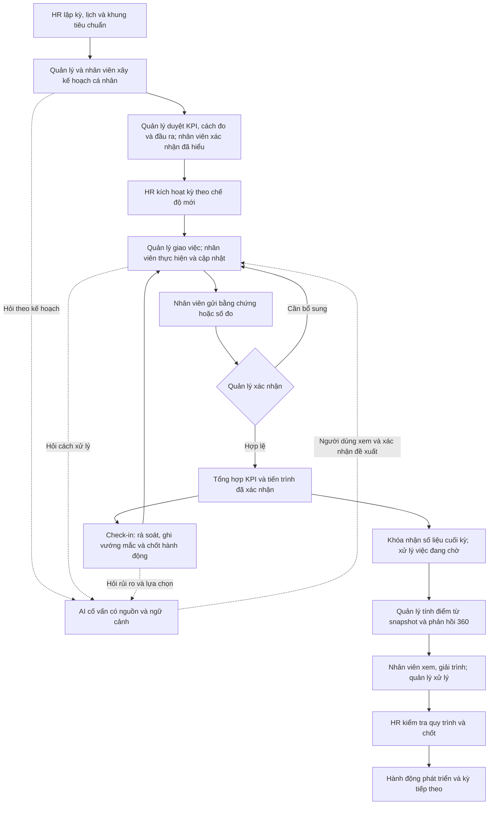
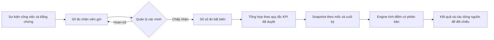
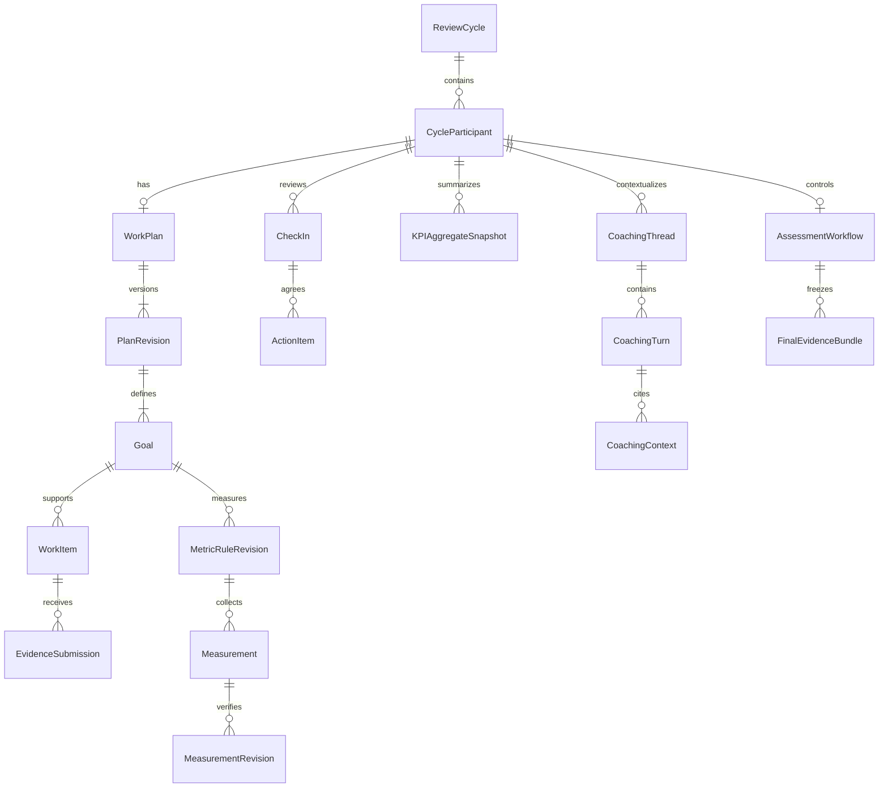

# Đề xuất nâng cấp InsightHR: quản lý cả quá trình làm việc

Ngày phân tích: **25/11/2026**. Mã nguồn đối chiếu: `3e32324`, migration `20261114_0010`.

**Trạng thái cập nhật 25/11/2026:** đây là đề xuất tổng thể ban đầu dựa trên baseline ghi phía trên. **Phase 11 đã triển khai và nghiệm thu local tại `13fd9e3`**; xem [báo cáo](phase-11-report.vi.md). **Phase 12 đã có kế hoạch và dự thảo contract, chưa triển khai**; Phase 13–15 tiếp tục là đề xuất. Những bảng mô tả “hiện tại” dưới đây ghi nhận thời điểm phân tích ban đầu, không thay thế báo cáo runtime mới nhất. Đây là hướng nâng cấp sau phần đã hoàn thành, không phải diễn giải lại rằng dự án từ đầu có sẵn 15 phase.

## 1. Kết luận và mục tiêu sản phẩm

InsightHR nên phát triển thành **hệ thống quản lý công việc gắn với mục tiêu hiệu suất, theo dõi tiến trình và cố vấn AI theo ngữ cảnh**. Kết quả cuối kỳ phải giải thích được bằng dữ liệu đã được ghi nhận trong kỳ.

Người xem cần trả lời được sáu câu hỏi:

1. Nhân viên được giao việc gì, nhằm đạt mục tiêu nào?
2. Hai bên đã thống nhất cách đo, tiêu chuẩn đạt và thời hạn ra sao?
3. Nhân viên đã làm gì, gặp trở ngại nào, có bằng chứng gì?
4. Quản lý đã xác nhận, phản hồi và hỗ trợ những gì?
5. AI đã tư vấn vào thời điểm nào, dựa trên dữ liệu nào, người dùng đã làm gì tiếp?
6. Số cuối kỳ được tổng hợp từ đâu và vì sao kết quả là như vậy?

**Luận điểm khi trình bày:** hệ thống giúp phát hiện và xử lý vấn đề trong quá trình thực hiện; báo cáo cuối kỳ là sản phẩm của quá trình đó. Chat và bảng tin hỗ trợ phối hợp, nhưng không thay thế các bản ghi giao việc, nghiệm thu và xác nhận số liệu.

## 2. Cơ sở tham khảo và cách vận dụng

- [CIPD — Performance management](https://www.cipd.org/en/knowledge/factsheets/performance-factsheet/): quản lý hiệu suất gồm mục tiêu, đối thoại thường xuyên, phản hồi và cải thiện; xem đây là một chu trình liên tục. Vận dụng: bổ sung trao đổi định kỳ có kết quả hành động, thay vì chỉ có nhận xét cuối kỳ.
- [OPM — Performance management cycle](https://www.opm.gov/policy-data-oversight/performance-management/performance-management-cycle/): mô tả các hoạt động lập kế hoạch, theo dõi, phát triển, đánh giá và ghi nhận. Vận dụng: tách trách nhiệm lập chuẩn, thực hiện, theo dõi và tổng kết.
- [OPM — Developing performance standards](https://www.opm.gov/policy-data-oversight/performance-management/reference-materials/articles/developing-performance-standards/): tiêu chuẩn cần rõ, đo được và thực tế, có thể xét chất lượng, khối lượng và thời gian. Vận dụng: mỗi KPI phải có định nghĩa nguồn số liệu và tiêu chuẩn nghiệm thu.
- [NIST AI 600-1](https://nvlpubs.nist.gov/nistpubs/ai/NIST.AI.600-1.pdf): nhận diện rủi ro AI đưa thông tin sai nhưng tự tin và người dùng phụ thuộc quá mức. Vận dụng: câu trả lời có nguồn nội bộ, phân biệt dữ kiện/giả định, con người xác nhận quyết định nghiệp vụ.
- [Google — Text generation, multi-turn conversations](https://ai.google.dev/gemini-api/docs/text-generation): có cơ chế hội thoại nhiều lượt. Vận dụng ở mức khả năng kỹ thuật; cách tích hợp phải được kiểm chứng với adapter và SDK đang khóa phiên bản trước khi code, không mặc định đổi SDK/model theo ví dụ mới trên website.

Các tài liệu trên là tham khảo phương pháp. Các trọng số, trạng thái, tần suất và quyền bên dưới là **thiết kế đề xuất cho InsightHR**, không phải quy định chung bắt buộc cho mọi doanh nghiệp. Tài liệu OPM có bối cảnh khu vực công Hoa Kỳ; không dùng nó để khẳng định tuân thủ pháp luật Việt Nam.

## 3. Đối chiếu với ứng dụng hiện tại

| Mảng | Hiện đã có, đối chiếu code | Khoảng trống ảnh hưởng ý nghĩa sản phẩm |
| --- | --- | --- |
| Tổ chức | Nhân viên, phòng ban, quản lý trực tiếp, tài khoản và quyền | Chưa nối cơ cấu với mục tiêu và công việc hằng ngày |
| Chu kỳ | DRAFT/ACTIVE/CLOSED, danh sách và snapshot khi kích hoạt | Chưa có kế hoạch cá nhân được thống nhất trước khi thực hiện |
| KPI | Target, weight, direction, actual; quản lý ghi actual trực tiếp | Chưa có chuỗi sự kiện tạo actual, tiêu chuẩn nghiệm thu, thời điểm đo và duyệt bằng chứng |
| Phản hồi | Phân công rõ người/quan hệ, gửi phiếu, bảo vệ nhóm nhỏ | Phản hồi 360 không thay cho việc rà soát tiến độ và giải quyết vướng mắc |
| Tính điểm | Công thức xác định, phiên bản, snapshot, chốt/đóng kỳ | Tái hiện được phép tính nhưng chưa tái hiện đầy đủ quá trình tạo dữ kiện đầu vào |
| AI | HR yêu cầu phân tích một phiên bản báo cáo đã có | Chưa có cố vấn hội thoại trước kết quả; nhân viên/quản lý chưa tự hỏi theo công việc |
| Chat/bảng tin/thông báo | Giao tiếp theo quyền, realtime, tin đã đọc | Tin nhắn chưa phải yêu cầu công việc hay quyết định nghiệp vụ có trạng thái |
| Dữ liệu mẫu | 60 nhân viên, 8 phòng, kỳ cũ và kỳ nháp mở rộng | Nhiều hồ sơ không đồng nghĩa có một câu chuyện làm việc từ đầu đến cuối |

Các điểm kiểm chứng chính:

- [AllocationService.actual](../apps/api/app/modules/kpis/allocations.py): nhận `ActualUpdate.actual`, kiểm tra quyền/version và cập nhật `row.actual`.
- [EmployeeKPI](../apps/api/app/modules/kpis/models.py): lưu target/actual/weight và snapshot định nghĩa, chưa có sổ đo theo thời gian.
- [Bộ thu thập bằng chứng](../apps/api/app/modules/performance/evidence.py) và [engine v1](../apps/api/app/modules/performance/engine.py): dùng các actual và rating đã gửi; rating hiện được tính theo trung bình các phiếu, chưa có trọng số theo nhóm quan hệ.
- [AIService](../apps/api/app/modules/ai/service.py) và [GenerateInput](../apps/api/app/modules/ai/schemas.py): gắn với review/calculation version, thao tác tạo hiện dành cho HR.
- [Điều hướng theo role](../apps/web/src/features/workspace/navigation-model.ts): chưa có khu vực công việc/kế hoạch/check-in.

Như vậy góp ý của giảng viên đúng về **khoảng trống theo dõi quá trình**. Nền tảng hiện có vẫn hữu ích để giữ phân quyền, lịch sử, công thức và chốt kết quả.

## 4. Phạm vi đủ thực tế nhưng vẫn làm được

Mục tiêu đầu tiên là quy trình của một công ty dịch vụ/văn phòng, kỳ đánh giá theo tháng hoặc quý, rà soát tuần hoặc hai tuần. Không cố làm đầy đủ ERP, Jira, CRM, kế toán hay lương thưởng.

**Bắt buộc trong bản nâng cấp đầu:** kế hoạch cá nhân, công việc có đầu ra, cập nhật và bằng chứng, duyệt/hoàn trả, KPI theo thời gian, check-in, AI cố vấn, liên kết kết quả cuối kỳ.

**Làm sau khi luồng chính đạt:** tích hợp CRM/Git/Jira, tệp tải lên, chat nhóm, dự báo thống kê, mục tiêu liên phòng phức tạp, nhiều công ty, kế hoạch khắc phục chính thức, lương/thưởng. Giai đoạn đầu chỉ lưu mô tả bằng chứng và URL tham chiếu; không tự truy cập URL hay giả định đã xác minh dữ liệu bên ngoài.

Một mục tiêu cá nhân được nối với mục tiêu phòng ban. HR nhập mục tiêu công ty đã được thống nhất ngoài hệ thống, quản lý liên kết mục tiêu phòng. Đây là ngữ cảnh và định hướng, không tự cộng điểm của các nhân viên thành điểm công ty.

## 5. Quy trình vận hành đề xuất



### 5.1 Chuẩn bị và thống nhất

HR quy định thời gian kỳ, hạn hoàn tất kế hoạch, lịch check-in, hạn ghi nhận, hạn xác minh và hạn phản hồi kết quả. Mỗi kỳ dùng một múi giờ cấu hình; lưu thời điểm UTC, hiển thị theo múi giờ kỳ. Các hạn có thứ tự, không cho lịch rà soát rơi ngoài kỳ.

Quản lý trực tiếp soạn kế hoạch cho từng người; nhân viên có thể đề xuất và yêu cầu làm rõ. Kế hoạch phải có mục tiêu, 3–5 KPI điển hình, cách đo, trọng số tổng 100%, mốc kỳ vọng, tiêu chuẩn bằng chứng và người xác minh. Số KPI là mặc định UX, không áp cho mọi nghề.

Quản lý duyệt kế hoạch của nhân viên trong phạm vi. Việc quản lý duyệt kế hoạch do chính mình soạn cho một nhân viên khác được phép; tự duyệt kế hoạch hiệu suất của chính mình bị chặn. Nhân viên xác nhận đã nhận/đã hiểu hoặc yêu cầu làm rõ; sự xác nhận này không phải chữ ký đánh giá hay bằng chứng đồng ý mọi kết luận.

Trong chế độ mới, HR chỉ kích hoạt khi các kế hoạch tham gia hợp lệ, được duyệt và không còn yêu cầu làm rõ chưa xử lý. Chưa xác nhận nhận kế hoạch thì phải nhắc và giải quyết, không tự đánh dấu hộ. Có thể loại người khỏi danh sách khi kỳ còn DRAFT, có lý do; không lặng lẽ bỏ người sau khi đã kích hoạt.

### 5.2 Thực hiện và nghiệm thu

Mỗi việc có một người chịu trách nhiệm chính, người giao/duyệt, mục tiêu liên quan, thời hạn, ưu tiên và đầu ra cần nghiệm thu. Người phối hợp không tự nhận điểm của cùng đầu ra.

Nhân viên bắt đầu việc, báo vướng mắc, ghi cập nhật và gửi kết quả. Quản lý nghiệm thu theo checklist hoặc trả lại kèm lý do. Bấm hoàn thành, khai tiến độ 100% hay nhắn “xong rồi” không tự tạo actual đã xác nhận.

Việc hành chính không cần KPI vẫn được quản lý như việc thường. Chỉ việc được gắn đóng góp KPI hợp lệ mới đi vào số đo. Khi tách một việc thành nhiều việc con, tổng đóng góp không tăng lên.

### 5.3 Theo dõi và rà soát

Nhân viên cập nhật khi có tiến triển/vướng mắc; không ép ghi nhật ký mỗi giờ. Mỗi tuần hoặc hai tuần có một check-in ngắn: đã làm, chưa làm, số liệu đã xác nhận, trở ngại, hỗ trợ cần có và hành động tiếp theo.

Quản lý phản hồi, quyết định ưu tiên, người hỗ trợ và hạn xử lý. Mỗi hành động có chủ sở hữu và trạng thái để tuần sau kiểm tra. Check-in là trao đổi hai chiều, không phải một phiếu chấm điểm 360 lặp lại mỗi tuần.

Hệ thống phân biệt “đang chờ nhân viên”, “đang chờ quản lý duyệt”, “bị chặn vì phụ thuộc” và “quá hạn”. Không quy mọi sự chậm trễ cho người thực hiện.

### 5.4 Cuối kỳ

Đến hạn, ngừng ghi nhận thông thường; số đo còn chờ duyệt phải được chấp nhận, trả lại hoặc loại trừ có lý do. Vướng mắc/check-in chưa xử lý phải được phân loại và ghi nhận người quyết định, không coi việc còn mở luôn là không đạt.

Quản lý tạo snapshot số liệu cuối kỳ, hoàn thành điều kiện phản hồi, rồi tính điểm. Nhân viên xem kết quả và có thời hạn giải trình; trạng thái được phép là đã nhận kết quả, có giải trình, đã xử lý giải trình hoặc quá hạn phản hồi được ghi nhận. Im lặng không được ghi thành “đồng ý”. HR chốt khi điều kiện quy trình đầy đủ; HR không sửa ngầm bằng chứng hay điểm quản lý đã tính.

Khi đã chốt, nội dung bất biến. Một đề nghị điều chỉnh muộn được lưu để xem xét; quy trình mở lại kết quả đã chốt chưa nằm trong MVP. Không mở khóa dữ liệu bằng quyền ADMIN hoặc gọi AI.

## 6. Trách nhiệm và quyền theo role

| Thao tác | HR | Quản lý trực tiếp | Nhân viên | ADMIN | AI |
| --- | --- | --- | --- | --- | --- |
| Lập kỳ, lịch, danh mục/quy tắc chuẩn | Chủ trì | Góp ý nghiệp vụ | Đọc phần liên quan | Cấu hình nền tảng | Đề xuất có người xác nhận |
| Soạn KPI/mục tiêu cá nhân | Đọc, kiểm tra quy trình | Soạn, duyệt người thuộc nhóm | Đề xuất, xác nhận đã hiểu | Không | Giúp viết rõ tiêu chuẩn |
| Giao việc | Theo dõi tổng hợp | Giao trong nhóm | Đề xuất việc, tự tạo bản nháp | Không | Đề xuất bản nháp |
| Cập nhật, gửi bằng chứng/số đo | Đọc theo phạm vi HR | Gửi cho việc mình thực hiện nếu có | Gửi phần của mình | Không | Không gửi thay |
| Xác minh số liệu/đầu ra | Theo dõi và yêu cầu xử lý | Xác minh; không duyệt chính đầu ra mình thực hiện | Không tự xác minh | Không | Không |
| Check-in | Theo dõi đủ/thiếu, điều phối | Phản hồi, hỗ trợ và chốt hành động | Báo cáo, góp ý, nhận hành động | Không | Chuẩn bị nội dung tham khảo |
| Chat với AI trong kỳ | Theo ngữ cảnh tổ chức được phép | Hỏi cho từng người thuộc nhóm | Hỏi cho chính công việc của mình | Không có quyền nghiệp vụ mặc định | Trả lời trong scope |
| Tính điểm | Kiểm tra | Tính/tính lại từ nguồn hợp lệ | Xem và giải trình | Không | Giải thích, không tính thay engine |
| Chốt kết quả/đóng kỳ | Chủ trì | Xử lý phần còn thiếu | Nhận thông báo | Không | Không |

Quyền mới của EMPLOYEE là quản lý **phần thực hiện và đề xuất của bản thân**, không phải tự sửa actual đã xác minh. HR vẫn là bên tổ chức/kiểm soát, không trở thành quản lý trực tiếp của mọi người.

Người có role MANAGER cũng là một người đi làm. Trong mô hình ban đầu, các trưởng phòng chưa có quản lý cấp cao trong dữ liệu demo nên chỉ được thực hành vai trò giao/duyệt. Nếu muốn đánh giá họ, phải cấu hình cấp quản lý hợp lệ trước; không để họ tự duyệt công việc hay kết quả của mình. HR tiếp tục không được đưa vào đánh giá theo phạm vi đã thống nhất.

## 7. Quy tắc KPI: nguồn dữ liệu phải đi trước điểm số

### 7.1 Hợp đồng của một KPI

Mỗi KPI cần tối thiểu:

| Nhóm | Trường/quy tắc |
| --- | --- |
| Ý nghĩa | Tên, mục tiêu liên quan, đơn vị, kỳ và người chịu trách nhiệm |
| Cách đo | SUM / DISTINCT_COUNT / RATIO / LAST_VALUE / WEIGHTED_MILESTONE |
| Nguồn | Số đo được duyệt, đầu ra nghiệm thu hoặc số liệu ngoài nhập có bằng chứng |
| Phạm vi | Đối tượng được tính, loại trừ hợp lệ, ngày sự kiện dùng để xếp kỳ |
| Chuẩn đạt | Target, chiều tốt/xấu, cap, trọng số, mốc kỳ vọng và tiêu chuẩn chất lượng |
| Trách nhiệm | Người nộp, người xác minh, hạn nộp và hạn xác minh |
| Kiểm soát | Khóa chống trùng, xử lý sửa số, lịch sử phiên bản và ngày hiệu lực |

Chỉ số càng cao càng tốt/càng thấp càng tốt được giữ, nhưng phải có cách tổng hợp riêng. “Càng thấp càng tốt” không đồng nghĩa SUM hay lấy trung bình.

### 7.2 Các quy tắc chống sai nghiệp vụ

1. **Tách số tự khai và số đã xác minh.** Dashboard hiển thị riêng; chấm điểm chỉ dùng số đã xác minh. “Quản lý xác nhận” là xác nhận nội bộ, không khẳng định đã tích hợp hay kiểm toán nguồn CRM.
2. SUM dùng phần tăng thêm của từng sự kiện. LAST_VALUE dùng bản đo snapshot mới nhất hợp lệ. Không cộng 20 + 35 + 50 nếu đó là ba lần báo cáo lũy kế cùng một chỉ số.
3. RATIO lưu tử số và mẫu số. Tổng kỳ là tổng tử/tổng mẫu, không lấy trung bình giản đơn các tỷ lệ tuần. Mẫu số 0 hoặc chưa có mẫu là **chưa đủ dữ liệu**, không tự thành 0% hoặc 100%.
4. DISTINCT_COUNT chống trùng theo mã hồ sơ/đầu ra/sự kiện và KPI/phiên bản quy tắc. Nộp lại hoặc gửi request lặp không tăng kết quả.
5. Mỗi đóng góp của một đầu ra vào một KPI chỉ được tính một lần. Một việc phục vụ nhiều KPI chỉ được khi đo các khía cạnh khác nhau và khai rõ; ví dụ thời hạn và chất lượng, không cộng cùng sản lượng hai lần.
6. WEIGHTED_MILESTONE có bộ mốc và trọng số cố định tổng 100%. Mốc được nghiệm thu mới đóng góp; số lượng việc con hoặc phần trăm tự khai không tăng điểm.
7. Tỷ lệ và chất lượng so với chuẩn tương ứng tại từng lần rà soát. Chỉ tiêu sản lượng theo lộ trình/mốc cam kết; không mặc định mọi nghề hoàn thành đều theo thời gian tuyến tính.
8. Thiếu số liệu khác kết quả thấp. Nghỉ được duyệt, đổi phạm vi hoặc kỳ chưa đủ thời gian phải đi qua điều chỉnh có lý do, không điền số 0 cho đẹp báo cáo.
9. Việc bị chặn hoặc ngày nghỉ không tự xóa khỏi mẫu số/SLA. Lịch làm việc, điều kiện dừng đồng hồ và trường hợp loại trừ phải được quy định trước và duyệt theo quyền.
10. Số giờ online, số tin nhắn, số lần hỏi AI và số task tạo ra không phải thước đo hiệu suất mặc định. Đếm sản lượng cần chuẩn đầu ra và kiểm tra chất lượng để tránh chia nhỏ việc nhằm tăng điểm.
11. Target bằng 0 chưa hỗ trợ bởi engine v1. KPI mới cần target dương hoặc một quy tắc ngưỡng/mốc thuộc engine phiên bản mới đã được đặc tả, không lách bằng một số rất nhỏ.
12. Đổi target, trọng số, cách đo hoặc phạm vi phải tạo phiên bản yêu cầu thay đổi, có lý do và ngày hiệu lực. Không ghi đè chuẩn cũ để làm đẹp các tuần đã qua. MVP không cho đổi giữa kỳ; xử lý có phiên bản được mở ở Phase 15.

Mỗi số đo phân biệt `occurred_at` (sự kiện xảy ra), `submitted_at` (hệ thống nhận), `verified_at` (hệ thống xác nhận) và kỳ được áp dụng. Sự kiện phải thuộc kỳ đo; hạn nộp có thể sau ngày kết thúc kỳ, hạn xác minh sau hạn nộp, theo lịch đã công bố. Không cho người dùng sửa thời điểm hệ thống để giả vờ đã nộp/duyệt sớm. Snapshot ghi cả cửa sổ sự kiện và thời điểm chốt dữ liệu.

Điều chỉnh trước cutoff tạo revision thay thế của **cùng nguồn số đo**. Tổng hợp lấy một revision đã xác minh có hiệu lực cho mỗi nguồn; không cộng cả bản cũ lẫn bản sửa. Trường hợp muốn xem lại tuần trước dùng snapshot/as-of của tuần đó, không để số tuần trước lặng lẽ thay đổi theo bản sửa mới.

KPI phải chọn mức chi tiết dữ liệu: sự kiện đơn lẻ hoặc lô theo khoảng kỳ không chồng lấn. Với lô tuần, số tháng do hệ thống cộng các lô tuần; không nhập thêm một lô tháng đè lên cùng phạm vi rồi tính cả hai. Bản nộp lô có nguồn tham chiếu, tử/mẫu và người xác minh; khi chưa tích hợp hệ thống ngoài thì chỉ khẳng định đã xác minh nội bộ, chưa bảo đảm chống trùng từng ticket bên ngoài.

### 7.3 Đường đi của một con số



Trạng thái công việc, tiến độ mục tiêu và mức đạt KPI là ba thông tin riêng. Việc 100% hoàn thành vẫn có thể trễ hạn hoặc không đạt chỉ tiêu chất lượng.

Để tránh thủ tục lặp, một bản nộp công việc có thể kèm bằng chứng và số đo. Khi KPI cấu hình nguồn là đầu ra của việc đó, thao tác nghiệm thu của quản lý tạo đóng góp đã xác minh trong cùng giao dịch. Không yêu cầu người dùng nhập lại cùng số ở màn hình KPI rồi duyệt thêm lần nữa. Chỉ số lấy từ nguồn khác hoặc lô định kỳ mới có bản đo riêng.

## 8. Trạng thái nghiệp vụ

| Đối tượng | Trạng thái/chuyển tiếp chính | Điều kiện quan trọng |
| --- | --- | --- |
| Kế hoạch | DRAFT → SUBMITTED → APPROVED; SUBMITTED → CHANGES_REQUESTED → DRAFT | Không sửa bản duyệt; nhân viên có trạng thái nhận/làm rõ riêng; trước kỳ phải xử lý hết yêu cầu làm rõ |
| Công việc | TODO → IN_PROGRESS → SUBMITTED → ACCEPTED; SUBMITTED → CHANGES_REQUESTED → IN_PROGRESS | BLOCKED là cờ có lý do/người xử lý, không đánh mất trạng thái; CANCELLED cần lý do và giữ lịch sử |
| Số đo | DRAFT → SUBMITTED → VERIFIED hoặc RETURNED | Đã VERIFIED không sửa/xóa; sai thì bản điều chỉnh tham chiếu bản trước, MVP chưa cho sửa sau cutoff |
| Check-in | DRAFT → SUBMITTED → REVIEWED | Quản lý ghi phản hồi và hành động; nhân viên xác nhận đã nhận, có thể bình luận khác ý kiến |
| Hành động sau check-in | OPEN → IN_PROGRESS → DONE hoặc CANCELLED | Chủ sở hữu, hạn và bằng chứng/nhận xét hoàn tất rõ |
| Kết quả kỳ mới | IN_PROGRESS → EVIDENCE_CUTOFF → RECONCILIATION → READY_FOR_SCORING → REVIEW_DISCUSSION → FINALIZED | Bổ sung workflow trên participant; không thay enum cũ bằng các trạng thái này |
| Hội thoại AI | OPEN hoặc ARCHIVED; mỗi lượt PENDING/SUCCEEDED/FAILED/STALE | Không tự chuyển trạng thái nghiệp vụ khác |

Mọi chuyển tiếp có kiểm tra quyền, thời hạn và `expected_version`. Gửi/lưu từ hai tab có xung đột phải yêu cầu tải lại; không tự ghi đè người khác. Không thêm nhánh “HR nhập hộ kết quả” hoặc “ADMIN duyệt hộ” để bỏ qua điều kiện.

## 9. AI cố vấn trong quá trình làm việc

### 9.1 Vai trò và ví dụ hỏi

| Giai đoạn | Ví dụ | Dữ liệu AI được xem | Kết quả hữu ích |
| --- | --- | --- | --- |
| Đầu kỳ | “KPI này đã rõ cách đo và bằng chứng chưa?” | Bản kế hoạch đang xem, danh mục chuẩn được phép | Chỉ ra mục tiêu mơ hồ, thiếu nguồn hoặc khó đo |
| Đang làm | “Tôi đang bị chặn vì thiếu xác nhận, nên xử lý thế nào?” | Công việc và vướng mắc của chính người hỏi | Đề xuất bước tiếp theo và câu hỏi cần làm rõ |
| Rà soát | “Tuần này tôi có nguy cơ không đạt chỉ tiêu nào?” | Mốc kỳ vọng, số đã xác minh, số đang chờ, hạn | Nêu rủi ro có dẫn chứng; không trộn số tự khai với số đã duyệt |
| Quản lý hỗ trợ | “Tôi cần trao đổi gì với Huy ở buổi check-in?” | Dữ kiện nghiệp vụ của Huy trong phạm vi hiện tại | Dàn ý trao đổi và hành động hỗ trợ |
| Cuối kỳ | “Vì sao điểm SLA thấp hơn kỳ vọng?” | Snapshot, quy tắc, kết quả engine và lịch sử được phép | Giải thích con số và bài học cho kỳ sau |

AI trả về phần tóm tắt, dữ kiện có nguồn, điểm chưa rõ/rủi ro, lựa chọn hành động và giới hạn. Không yêu cầu AI trả chuỗi suy luận nội bộ; cần lời giải thích ngắn kiểm tra được và đường dẫn bằng chứng.

### 9.2 Quyền riêng tư và nguồn

- Một hội thoại có người sở hữu, nhân viên/ngữ cảnh, kỳ, quyền xem và phiên bản dữ liệu. Nhân viên hỏi cho mình; quản lý hỏi cho người trực tiếp; HR hỏi phần được quyền theo nghiệp vụ.
- Hội thoại cố vấn **riêng của nhân viên không tự mở cho quản lý/HR** và không tự trở thành bằng chứng đánh giá. Chia sẻ một đoạn sang check-in là thao tác riêng, hiện bản xem trước, người nhận và các nguồn kèm theo.
- Quyền đọc dữ liệu nghiệp vụ của HR không đồng nghĩa quyền đọc chat cố vấn riêng. AI PRIVATE của báo cáo HR cũ vẫn tách khỏi cố vấn cá nhân mới.
- Kiểm tra scope trên server trước mỗi lượt gửi, đọc lại, dẫn nguồn và chia sẻ. Mất quyền quản lý/đổi liên kết nhân viên thì không được truy cập lại ngữ cảnh cũ chỉ vì đã có thread ID.
- Nguồn có ID và version. ID do AI tự nêu phải được kiểm tra thuộc tập ngữ cảnh đã gửi; không hiện một liên kết hoặc tên nhân viên ngoài quyền. Nội dung người dùng gõ là lời khai, không tự thành dữ kiện đã xác minh.
- Không gửi toàn bộ công ty, phản hồi 360 gốc của người khác hoặc PRIVATE HR vào hội thoại nhân viên. Không gộp lịch sử từ hai phạm vi khác nhau vào một phiên provider.

### 9.3 Hành động và giới hạn kỹ thuật

AI có thể đề xuất “tạo việc nháp”, “đề nghị điều chỉnh hạn”, “chuẩn bị check-in”. Ứng dụng hiện bản xem trước; người dùng chủ động chọn, rồi API nghiệp vụ kiểm tra quyền/version và thực hiện. AI không tự giao việc, nghiệm thu, sửa số, đánh giá nhân cách, quyết định tuyển/sa thải, hay chốt điểm.

Các phát biểu như “đang chậm theo mốc”, tỷ lệ đạt và điểm số được tính bằng code từ dữ liệu xác định. AI diễn giải và gợi ý cách xử lý; không thay engine bằng một yêu cầu “hãy chấm nhân viên này”.

Giữ adapter Gemini và `.env` hiện tại. Thêm hợp đồng hội thoại mới, không tái sử dụng ép buộc schema sáu trường của báo cáo sau kỳ. Dữ liệu lịch sử do server chọn theo quyền, giới hạn lượt/ngữ cảnh/kích thước và ngân sách cấu hình. Không lưu prompt chứa dữ liệu riêng vào audit hoặc log chung. Không giữ transaction/khóa DB trong lúc gọi provider.

Mỗi lượt có `client_request_id`, trạng thái reservation, hạn và fence. Lưu ngữ cảnh/nguồn/model/schema version để biết câu trả lời dựa trên gì; thay đổi dữ liệu trong lúc gọi thì đánh dấu nguồn cũ, kiểm tra quyền lại trước trả kết quả. Timeout/quota giữ tin người dùng, không tự gửi lại tính phí; giải thích rằng không thể bảo đảm external billing đúng một lần khi phản hồi mạng bị mất.

Mất AI không chặn giao việc, xác minh hay tính điểm. Nạp demo không gọi provider; kiểm thử phần lớn dùng fake adapter. Thử Gemini thật là lượt nghiệm thu riêng, dữ liệu hư cấu, xác nhận chi phí và ghi rõ model/thời điểm.

## 10. Một ví dụ có đầu–cuối để trình bày với giảng viên

**Tình huống giả định:** Huy (`care01.demo@example.com`), CSKH, một kỳ 4 tuần. Hoàng Mai Anh (`care.manager.demo@example.com`) quản lý. Các ngày/tình tiết dưới đây là kịch bản cần xây, chưa phải dữ liệu đã có trong DB.

| KPI | Mục tiêu và nguồn | Trọng số nội bộ KPI |
| --- | --- | ---: |
| Yêu cầu xử lý đúng SLA | 95%; số yêu cầu hợp lệ xử lý đúng hạn / tổng yêu cầu hợp lệ | 60% |
| Chất lượng trả lời | 90%; đạt checklist / mẫu QA có quy tắc chọn trước, ví dụ 5 yêu cầu mỗi tuần | 25% |
| Tài liệu hướng dẫn được nghiệm thu | 4 tài liệu theo 4 đầu ra đã thống nhất; không đếm bản nháp hay việc con | 15% |

**Đầu kỳ:** quản lý và Huy thống nhất định nghĩa “hợp lệ”, SLA theo giờ làm việc, checklist QA, cách chọn mẫu, 4 đầu ra tài liệu, lịch check-in. Nhân viên xác nhận đã hiểu; HR kích hoạt sau khi đủ điều kiện.

**Tuần 1–2:** phát sinh 40 yêu cầu hợp lệ, 30 xử lý đúng SLA. Quản lý đã xác nhận 30/40 = 75%. Huy ghi các trường hợp đang chờ phối hợp. Hệ thống hiển thị 75% so với chuẩn 95%, riêng với số đang chờ xác minh; không lấy 95% × nửa tháng làm chuẩn SLA.

**Hỏi AI:** “Tôi cần cải thiện điều gì trong hai tuần tới?” AI viện dẫn tỷ lệ 30/40, các yêu cầu đã trễ và vướng mắc được phép đọc; gợi ý phân loại ưu tiên, mốc nhắc trước SLA, yêu cầu hỗ trợ. Nếu chưa có dữ liệu nguyên nhân, AI hỏi lại thay vì kết luận “thiếu trách nhiệm”.

**Check-in:** quản lý xác nhận nguyên nhân còn thiếu, giao một hành động hỗ trợ cụ thể và hạn xử lý. Huy nhận hành động; tuần sau xem việc đã hoàn tất và tỷ lệ mới có cải thiện hay không. Việc hỏi AI không tăng điểm.

**Cuối kỳ:** toàn kỳ có 100 yêu cầu hợp lệ, 90 đúng SLA; QA đạt 18/20; 4 tài liệu được nghiệm thu. Mẫu số cuối kỳ 100 đã gồm 40 yêu cầu đầu, không cộng thêm snapshot 40 lần nữa. SLA cuối kỳ là 90%, không trung bình giản đơn của 75% và 90%.

Với cap không ảnh hưởng các dòng này, engine tương thích công thức hiện có:

```text
SLA:        (90 / 95 × 100) × 60% = 56,842105...
Chất lượng: (90 / 90 × 100) × 25% = 25
Tài liệu:   ( 4 /  4 × 100) × 15% = 15
Điểm KPI = 96,842105... → hiển thị 96,84

Giả định điểm phản hồi hợp lệ = 80;
policy KPI/phản hồi = 70/30:
Điểm cuối = 96,842105... × 70% + 80 × 30% = 91,789473... → 91,79
```

Không lấy các giá trị từng dòng đã làm tròn để tính tiếp. Nhận xét cuối phải nêu **SLA đã cải thiện nhưng vẫn chưa đạt chuẩn 95%**, dù điểm tổng cao nhờ hai chỉ tiêu khác. Có thể bấm từng dòng để xem nguồn, người xác minh và check-in đã hỗ trợ gì.

Khi demo: cho thấy trạng thái ở từng tuần, câu hỏi AI tại tuần 2, hành động được con người chọn, bằng chứng tuần 3–4, rồi kết quả. Dùng đồng hồ giả lập trong bộ test hoặc dữ liệu sự kiện có ngày rõ, không đổi thời gian hệ thống hay sửa ngày DB đang dùng chỉ để diễn trình.

## 11. UX: làm rõ việc cần làm thay vì thêm nhiều menu

Giữ header, sidebar trái, thông báo và chat người–người hiện tại. Bổ sung **một nhóm Công việc & mục tiêu**, không tạo một menu độc lập cho mỗi bảng dữ liệu.

| Role | Điểm vào hằng ngày | Nội dung ưu tiên |
| --- | --- | --- |
| Nhân viên | Công việc của tôi | Việc hôm nay, việc chờ bổ sung, tiến độ đã xác minh, kỳ check-in tới |
| Quản lý | Điều phối nhóm | Chờ duyệt đầu ra/số đo, vướng mắc cần hỗ trợ, check-in đến hạn, người có nguy cơ thiếu mốc |
| HR | Điều phối kỳ | Kế hoạch chưa thống nhất, thiếu check-in, backlog xác minh, hồ sơ sắp chốt; không chiếm màn hình bằng task chi tiết toàn công ty |
| ADMIN | Quản trị hiện tại | Không hiện giao việc, xác minh hoặc AI nghiệp vụ |

Kế hoạch/công việc mở trong drawer hoặc modal có các tab nhất quán: **Nội dung – Tiến trình & bằng chứng – Trao đổi – Lịch sử**. Chỉ hiện nút hợp lệ với role/trạng thái; sai quyền phải bị server chặn cả khi gọi URL trực tiếp.

Trang tiến trình có đường mốc kỳ vọng và số đã xác minh, lớp số tự khai ghi nhãn riêng; biểu đồ tỷ lệ hiển thị tử/mẫu. Trạng thái rủi ro dùng chữ/biểu tượng cùng màu, không dùng màu đơn độc. Chi tiết hỗ trợ bàn phím, đóng bằng X/Escape và giữ bộ lọc nền; trên mobile chuyển thành khung gần toàn màn hình.

**Cố vấn AI** là panel theo ngữ cảnh với gợi ý câu hỏi, nguồn, thời điểm dữ liệu và cảnh báo thiếu dữ kiện. Phân biệt rõ với nút **Chat nội bộ** giữa người với người. Không tự mở hai panel chồng nhau hay mất bản nháp khi đổi tab. Câu trả lời AI được chia sẻ mới xuất hiện trong trao đổi công việc.

Thông báo phải nêu ai cần làm gì và mở đúng đối tượng: nhận kế hoạch, nhận việc, cần bổ sung, có số chờ duyệt, có phản hồi, check-in đến hạn, kết quả chờ xem. Không thông báo mọi lần gõ/cập nhật nháp. Thông báo đã đọc không đồng nghĩa công việc đã hoàn tất.

## 12. Kiến trúc, dữ liệu và tích hợp

Giữ Next.js + FastAPI modular monolith + PostgreSQL. Chưa cần microservice, Redis, Kafka, vector database hoặc một hệ thống chat khác. Tái sử dụng auth/CSRF, version check, audit trong giao dịch, SSE và các shell/dialog hiện có.

Các nhóm dữ liệu đề xuất, được tách dần theo phase:

| Module | Đối tượng chính | Ràng buộc cần có |
| --- | --- | --- |
| work_management | WorkPlan, PlanRevision, Goal, WorkItem, WorkItemEvent, EvidenceSubmission | Cycle/participant ownership, plan version, due date, actor, người nghiệm thu, lịch sử chuyển tiếp |
| progress | MetricRuleRevision, Measurement, MeasurementRevision, KPIAggregateSnapshot | Khóa chống trùng nguồn; RATIO có numerator/denominator; VERIFIED bất biến; snapshot có cutoff và hash |
| check_ins | CheckIn, CheckInResponse, ActionItem | Unique(participant, period), phản hồi theo version, người chịu trách nhiệm/hạn |
| coaching | CoachingThread, CoachingTurn, CoachingContext, SharedExcerpt | Owner/scope, danh sách nguồn/version, lease/fence, kiểm tra chia sẻ, không dùng bảng chat người–người |
| performance mở rộng | AssessmentWorkflow, FinalEvidenceBundle, ResultResponse | Chế độ workflow, readiness cuối kỳ, phản hồi/giải trình và gắn bundle vào revision kết quả |



Sơ đồ là quan hệ khái niệm; schema phải được chuẩn hóa trong contract trước migration. Quan hệ khai báo thuộc cùng cycle/participant/plan phải được kiểm tra bằng FK ghép hoặc kiểm tra dịch vụ trong cùng giao dịch, không chỉ kiểm tra từng UUID riêng lẻ.

**Khóa và phiên bản:** giữ thứ tự guard tổ chức → ADMIN/user đã sắp xếp → session family → cycle → participant → plan/work item/measurement theo ID. Không thêm khóa ngược với auth/organization. Dùng `work_version` và `measurement_version` cho nháp/tiến trình; chỉ cập nhật `evidence_version` khi thay đổi dữ liệu được đưa vào đánh giá. Không làm một lần gõ chat khiến điểm cũ thành STALE.

**Tổng hợp:** một hàm thuần dùng ledger đã xác minh và rule revision; tính định lượng không qua Gemini. Chấp nhận số đo, cập nhật snapshot hiện hành, audit và tín hiệu làm mới trong một giao dịch, hoặc ghi event và buộc rebuild được kiểm chứng trước khi tính điểm. MVP ưu tiên tổng hợp đồng bộ cho dữ liệu vừa phải; giới hạn truy vấn và phân trang.

**Nhắc hạn:** SSE chỉ vận chuyển tín hiệu, không tự chạy công việc theo lịch khi không có người mở trang. Danh sách Việc cần làm được suy ra từ dữ liệu lúc đọc. Muốn tạo thông báo đến hạn khi mọi người offline, cần lệnh chạy định kỳ bằng worker/container nhẹ hoặc scheduler triển khai hiện có, có khóa lease và unique(event, recipient, period). Không chạy một scheduler trong mỗi request hoặc mỗi API replica. Chỉ thêm hạ tầng này khi có task nghiệm thu riêng; không gọi Gemini từ lịch nền.

## 13. Tương thích với dữ liệu và API cũ

1. Thêm chế độ kỳ `LEGACY` / `CONTINUOUS`, mặc định mọi kỳ cũ là LEGACY. Không suy ra lịch sử công việc từ actual hiện tại hoặc bịa lại check-in.
2. Kỳ LEGACY tiếp tục dùng API, engine và quyền đã có. Chỉ chọn CONTINUOUS ở kỳ DRAFT mới; không đổi qua lại khi đã có kế hoạch được duyệt/kỳ hoạt động.
3. Với CONTINUOUS, mục tiêu/trọng số đến từ bản kế hoạch được duyệt trước kích hoạt. Sau kích hoạt, actual đến từ ledger; API nhập actual trực tiếp và PUT thay toàn bộ phân bổ cũ phải trả lỗi rõ `managed_by_workflow`.
4. Adapter có thể xuất target/actual/weight phù hợp sang cấu trúc engine v1 cho các metric đã tương thích. Nhưng vẫn phải lưu `evidence_schema_version`, provenance bundle và chế độ thu thập; không giả vờ một actual mới có cùng nguồn như nhập tay.
5. V1 không hỗ trợ quy tắc zero-target, thay chuẩn giữa kỳ hoặc trọng số phản hồi theo nhóm. Những khả năng này cần đặc tả/version engine mới và test lịch sử riêng, không sửa hằng `ENGINE_VERSION` rồi tính lại toàn bộ dữ liệu cũ.
6. Tạo demo CONTINUOUS mới có tên/marker riêng, không thay kỳ ACTIVE mà người dùng đang thực hành. Do hiện chỉ cho một kỳ ACTIVE, demo luồng mới chạy trong stack biệt lập hoặc sau khi người dùng hoàn tất kỳ cũ.
7. Mỗi migration/seed có sao lưu, đối chiếu bản ghi cũ, chạy lại không tạo trùng. Không reset `.env`, mật khẩu, dữ liệu chat hoặc kết quả để làm việc nâng cấp thuận tiện hơn.

## 14. Các tình huống văn phòng phải xử lý rõ

| Tình huống | Cách xử lý đề xuất |
| --- | --- |
| Quản lý giao việc cho người ngoài nhóm | Chặn ở API; nhờ quản lý của nhóm đó phối hợp; chưa mở quyền toàn công ty |
| Nhân viên tự đề xuất việc | Lưu bản nháp, quản lý chấp nhận phạm vi và cách đóng góp trước khi tính KPI |
| Nhân viên đánh dấu hoàn thành nhưng thiếu bằng chứng | Chờ bổ sung; chưa có đóng góp đã xác minh |
| Quản lý chưa duyệt quá lâu | Hiện backlog và người đang giữ bước; nhắc theo SLA duyệt; HR điều phối, không tự đổi số |
| Số đo gửi hai lần hoặc hai reviewer cùng duyệt | Khóa idempotency/unique/version; chỉ một quyết định và một đóng góp có hiệu lực |
| Số đã xác minh sai | Đề nghị điều chỉnh tham chiếu bản cũ; tạo revision mới, không sửa lịch sử; tính lại snapshot liên quan |
| Đổi mục tiêu hoặc xin lùi hạn | MVP: đề nghị được ghi nhưng chuẩn đã duyệt không tự đổi; Phase 15 duyệt thay đổi có ngày hiệu lực, giữ hạn gốc và lý do |
| Người nghỉ phép/việc bị hủy | Ghi lý do, xử lý phạm vi kỳ theo quy tắc; không tự trừ điểm hay xóa mẫu số |
| Chuyển phòng hoặc đổi quản lý giữa kỳ | MVP CONTINUOUS chặn thao tác ảnh hưởng thành viên đang chạy, trả lý do cho HR; Phase 15 thêm bàn giao có phạm vi từ thời điểm hiệu lực |
| Khóa tài khoản khẩn cấp | Vẫn cho khóa bảo mật; hồ sơ đánh dấu chờ người xử lý có quyền, không để workflow tự duyệt hoặc bỏ bản ghi |
| Chat có thỏa thuận về deadline | Cần tạo đề nghị thay đổi chính thức; người bấm link chat không tự có quyền sửa việc |
| AI suy đoán nguyên nhân hoặc đưa nguồn lạ | Không công nhận là bằng chứng; kiểm tra nguồn, hỏi thêm, cho người dùng báo câu trả lời chưa đúng |
| Không có dữ liệu giữa kỳ | Hiện chưa đủ dữ liệu; nhắc vai trò đang cần cung cấp/xác minh; không tạo điểm ảo |
| Có giải trình kết quả | Tạm chặn chốt cho tới khi có phản hồi được ghi nhận hoặc quyết định theo quy trình quá hạn đã công bố |

Giới hạn MVP cần hiện rõ trên giao diện và tài liệu; tránh gọi một luồng “thực tế hoàn chỉnh” khi chưa xử lý thay đổi tổ chức giữa kỳ.

## 15. Lộ trình triển khai đề xuất

Năm phase dưới đây là **phần mở rộng đề xuất** sau Phase 10. Không phải số phase cố định của toàn dự án; có thể tách/gộp khi chốt contract, không được bỏ gate nghiệp vụ và phân quyền.

| Phase | Kết quả sử dụng được | Phụ thuộc | Điều kiện nghiệm thu |
| --- | --- | --- | --- |
| **11 — Kế hoạch và công việc** | Kỳ CONTINUOUS, kế hoạch được thống nhất, giao việc và nghiệm thu có lịch sử | Nền tảng hiện tại | Nhân viên thực sự làm/cập nhật; quản lý giao/duyệt đúng scope; KPI cuối kỳ mới chưa được công bố nếu chưa có ledger |
| **12 — KPI theo tiến trình và check-in** | Số đo tự khai/xác minh, tổng hợp theo thời gian, buổi rà soát và hành động hỗ trợ | 11 | Không đếm trùng; tỷ lệ/lũy kế đúng; cảnh báo có quy tắc; hiển thị ai đang cần xử lý |
| **13 — AI cố vấn theo ngữ cảnh** | Nhân viên/quản lý hội thoại trong kỳ; nguồn, quyền riêng tư, chia sẻ và đề xuất có xác nhận | 11–12 | Hỏi được khi chưa có điểm cuối; nguồn có thật; không lộ dữ liệu và không tự sửa hệ thống |
| **14 — Đánh giá cuối kỳ có nguồn và giải trình** | Cutoff, đối soát, bundle, engine bridge, thảo luận kết quả, HR chốt | 11–13 | Demo trọn vòng từ đầu kỳ đến điểm cuối; mọi actual lần ngược được về nguồn |
| **15 — Thay đổi giữa kỳ và nghiệm thu thực tế** | Điều chỉnh baseline/hạn, bàn giao quản lý, vận hành nhắc hạn, mở rộng demo và đo hiệu quả | 14 | Kịch bản thay đổi không làm mất lịch sử/quyền; thử người dùng và kiểm chứng cải thiện thao tác |

Không chờ Phase 15 mới làm quyền truy cập, audit, kiểm thử lỗi, responsive hay bảo toàn dữ liệu. Các yêu cầu này là gate của **từng phase**.

MVP để trình giảng viên là một lát cắt của **11–14** cho một nhóm, một kỳ 4 tuần, ba KPI và một nhân viên đầy đủ dữ liệu. Sau khi lát cắt này hoạt động mới nhân rộng ra 60 người; không cần tạo hàng nghìn bản ghi để chứng minh nghiệp vụ.

Ước lượng quy mô: 11 lớn; 12 lớn; 13 vừa–lớn do quyền và đánh giá chất lượng AI; 14 lớn; 15 phụ thuộc các ngoại lệ được chọn. Chưa gán ngày hoàn thành khi chưa biết hạn nộp, số người làm và thời gian nghiệm thu; mỗi phase chỉ lập ước lượng sau khi chốt contract và chia task có đầu ra.

## 16. Kiểm chứng “hiệu quả hơn” bằng điều gì?

| Tiêu chí | Cách đo nghiệm thu |
| --- | --- |
| Rõ trách nhiệm | Mỗi bước chờ chỉ ra người cần làm, thao tác tiếp theo và hạn |
| Truy xuất kết quả | 100% actual của kỳ CONTINUOUS có rule revision, cutoff và nguồn đã xác minh; số không nguồn bị chặn |
| Đúng số học | Fixture SUM/RATIO/LAST/MILESTONE, mẫu số 0, trùng nguồn, điều chỉnh, làm tròn và thời điểm biên có đáp án xác định |
| Đúng phân quyền | Ma trận role × chủ thể × trạng thái × hành động, gồm giả UUID, role đổi giữa request, không tự duyệt |
| Tính nguyên tử | Lỗi lưu audit/notification/snapshot thì hoàn tác; kiểm tra replay, submit/verify đồng thời, khóa kỳ khi đang cập nhật |
| AI có căn cứ | Bộ câu hỏi có dữ liệu/thiếu dữ liệu/nguồn độc hại/ngoài quyền; nguồn được server chấp nhận phải thuộc ngữ cảnh được phép |
| AI hữu ích | Người thử chấm mức đúng dữ kiện, đúng ngữ cảnh, hành động thực hiện được và biết nói thiếu dữ liệu; đặt ngưỡng trước thử, không tự tuyên bố AI “chính xác 100%” |
| Trải nghiệm | Người thử hoàn tất giao việc → nộp → duyệt → check-in → xem kết quả; ghi số lần nhờ hướng dẫn, sai thao tác và thời gian trước/sau |
| Khả năng vận hành | Đo truy vấn, độ trễ và lỗi với dữ liệu 60 người và dữ liệu lớn hơn trong môi trường test được ghi rõ; không suy ra production-ready từ số lượng test |
| Tương thích | Kỳ/dữ liệu cũ vẫn đọc và thao tác như trước; seed mới không thay bản ghi cũ; `.env` và AI key giữ nguyên |

Thử tối thiểu các nhóm nhân viên, quản lý và HR bằng dữ liệu hư cấu. Đây là đánh giá khả dụng và tính đúng, không phải nghiên cứu chứng minh tăng năng suất doanh nghiệp khi chưa có pilot thực tế.

## 17. Những quyết định mặc định cần giữ khi bắt đầu

1. Giữ bốn role, HR tổ chức/chốt, quản lý giao/duyệt, nhân viên cung cấp quá trình.
2. Giữ hai chế độ kỳ; không nâng cấp ngầm kỳ đã có.
3. Không dùng tỷ lệ task DONE làm điểm mặc định; mọi actual mới qua nguồn và quy tắc.
4. Không thêm một “điểm quá trình” tùy ý rồi cộng vào 70/30. Dữ liệu quá trình trước hết giải thích/tạo KPI; muốn thêm năng lực/hành vi phải định nghĩa rubric và engine riêng để tránh tính hai lần.
5. Giữ công thức phản hồi v1 cho lát cắt tương thích, công bố hạn chế trọng số nhóm. Nếu doanh nghiệp muốn SELF/MANAGER/PEER có tỷ trọng riêng, đặc tả và nghiệm thu phiên bản mới trước khi áp dụng.
6. Cố vấn AI có thể dùng trước báo cáo cuối; hội thoại riêng không trở thành hồ sơ chấm điểm mặc định.
7. Mỗi phase phải có màn hình dùng được và luồng demo theo role, không chỉ API hoặc sơ đồ.
8. Cài đặt/triển khai chỉ sau khi kế hoạch và contract của phase tương ứng được duyệt; phân tích này không tự đổi code hay dữ liệu đang dùng.

Chi tiết bước đầu: [kế hoạch Phase 11](superpowers/plans/2026-11-25-phase-11-work-management.md).

Bước tiếp theo sau Phase 11: [kế hoạch Phase 12 — sổ đo KPI và check-in](superpowers/plans/2026-11-25-phase-12-measurements-checkins.md), [dự thảo contract](phase-12-contract.vi.md). Phạm vi đầu dùng SUM/LAST/RATIO/MILESTONE đúng với code Phase 11; chưa nhận lô thời gian chồng lấn hoặc phương pháp DISTINCT_COUNT riêng. Đây là thu hẹp phạm vi triển khai có chủ ý, không phải xác nhận toàn bộ mô hình khái niệm của đề xuất đã được hiện thực.
