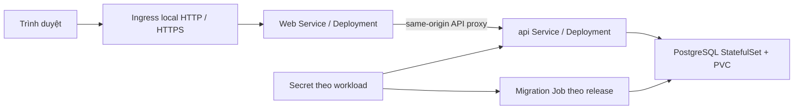

# Hợp đồng Phase 10 — Kubernetes và tài liệu triển khai

Ngày lập: **24/10/2026**, nghiệm thu **25/10/2026**. Trạng thái: **đã triển khai và nghiệm thu local**, tooling `d4a78bc`; bằng chứng và CI trong [báo cáo Phase 10](phase-10-report.vi.md).

Baseline: runtime Phase 9 `9821e82`, tài liệu `845676a`; [full CI](https://github.com/Tich-ne1625/HRM-AI-PRO/actions/runs/40109252558) đạt 843 backend/140 web tests, [browser/upgrade/persistence CI](https://github.com/Tich-ne1625/HRM-AI-PRO/actions/runs/40109315010) đạt. Tham chiếu [báo cáo Phase 9](phase-9-report.vi.md), [kiến trúc](architecture.md) và [kế hoạch thực hiện](superpowers/plans/2026-10-24-phase-10-kubernetes-docs.md).

## 1. Mục tiêu và phạm vi

Đưa ứng dụng đã có lên **Kubernetes local có thể tái lập**, kiểm chứng ingress, cấu hình/secret, migration, khởi động, bảo toàn dữ liệu và khôi phục backup. Hoàn thiện hướng dẫn tiếng Việt để người dùng chọn Compose cho chạy thường ngày hoặc Kubernetes cho học/nghiệm thu triển khai.

Không thêm nghiệp vụ, màn hình, API hoặc schema domain mới. Không đổi công thức điểm, phân quyền, xác nhận gọi AI hay snapshot lịch sử. Không chuyển dữ liệu demo của người dùng sang cluster tự động. Không triển khai cloud/production, registry riêng, HA PostgreSQL, Helm/operator, service mesh, autoscaling hoặc hệ thống giám sát ngoài phạm vi. NetworkPolicy chỉ được tuyên bố có hiệu lực nếu CNI thật sự enforce và có thử deny; phase này không dùng một YAML chưa kiểm chứng để gọi là network isolation.

Bổ sung theo yêu cầu triển khai của người dùng: tinh gọn UI trên các trang hiện có (menu theo nhóm đang mở, form/chi tiết mở khi cần, dashboard theo role) và README Việt. Phân quyền, dữ liệu/công thức và xác nhận thao tác vẫn giữ nguyên; không thêm màn hình nghiệp vụ mới. Xem [các thay đổi và kiểm chứng UI](phase-10-report.vi.md#giao-diện-đã-tinh-gọn).

Kubernetes không thay thế Compose đang chạy. Cluster thử nghiệm, cổng, namespace, volume và secrets tách biệt. Không đổi `.env`, Docker context hoặc kube context mặc định của người dùng để triển khai tự động.

## 2. Đối chiếu hiện trạng

| Hiện có | Tác động đến Phase 10 |
| --- | --- |
| Dockerfile API/web nhiều stage, UID/GID 10001, không chứa env/test harness | Tái sử dụng; build/import image có tag theo commit, không rebuild trong pod |
| Next.js rewrite `API_INTERNAL_URL` đọc lúc build, mặc định build Docker là `http://api:8000` | Service API giữ tên `api` trong cùng namespace; đặt env runtime khác không tự sửa rewrite |
| Compose migration chạy trước API bằng depends_on | Kubernetes cần điều phối Job hoàn tất trước rollout; apply nhiều YAML không bảo đảm thứ tự sẵn sàng |
| API `/health/live` và `/health/ready`; ready kiểm tra PostgreSQL/Alembic head | Liveness không dùng DB; readiness bắt buộc DB và head; không probe Gemini |
| Production config yêu cầu secure cookie và signing key riêng | Tách HTTP local và HTTPS local; giữ exact Origin/CSRF, không sửa validator để dễ triển khai |
| Head `20261024_0008`, demo idempotent chỉ development/test | Không migration mới theo kế hoạch; seed explicit trong local test, không seed khi startup/production |
| Session/limiter/AI lease ở PostgreSQL | Không cần Redis/session sticky; scale ứng dụng chỉ được công nhận sau kiểm tra nhiều replica |
| Các script Phase 9 có guard Compose/cổng/DB cố định | Không chạy nguyên script vào cluster; tách transport/harness hoặc tạo runner K8s có guard tương đương |
| Máy có kubectl; chưa tìm thấy kind/k3d trên PATH khi lập kế hoạch | Preflight phải kiểm tra/cài công cụ theo phạm vi khi triển khai, chưa coi có cluster sẵn |

## 3. Topology được chọn

Mặc định **k3d một server, không agent**, dùng ingress Traefik và local-path storage của K3s. Chọn một đường chạy để giảm chi phí kiểm thử/tài liệu; kind là lựa chọn sau này, không thêm ma trận hai cluster runtime trong phase này. Tài liệu chính thức: [k3d expose qua load balancer](https://k3d.io/stable/usage/exposing_services/), [K3s packaged components](https://docs.k3s.io/installation/packaged-components), [K3s storage](https://docs.k3s.io/add-ons/storage).

Tên dự kiến: cluster `insighthr-phase10`, kube context `k3d-insighthr-phase10`, namespace thực hành `insighthr-local`, namespace nghiệm thu `insighthr-phase10-acceptance`. Cổng host dự kiến HTTP **13010**, HTTPS **13443**, kiểm tra trống trước khi tạo. Không chiếm 3000/8000/5432 của hệ thống đang dùng. API và PostgreSQL dùng ClusterIP, không public NodePort/hostPort.

Ingress chỉ chuyển `/` tới web; `/api/v1/*` tiếp tục đi qua Next proxy đã nghiệm thu. Không rewrite mất prefix/Origin/cookie, không mở trực tiếp API vì tiện thử. TLS kết thúc tại ingress; API/web vẫn dùng cấu hình public origin chính xác. Service name `api` khớp URL build; DNS namespace tách các bộ dữ liệu.

Phiên bản k3d/K3s, ingress, schema validator và image digest được kiểm tra/pin ở Task 1 rồi ghi vào báo cáo thực thi. Không đưa `latest` hoặc một số phiên bản chưa chạy thành mốc nghiệm thu trong kế hoạch.

## 4. Artifact và cấu hình

Dự kiến `infrastructure/kubernetes/` có `base`, overlay `local-http`, `local-https`, tài nguyên migration riêng, cấu hình cluster và README ngắn. Dùng Kustomize đi kèm kubectl, không thêm Helm khi chưa có nhu cầu. Manifest Job không nằm trong bundle apply lại mỗi lần rollout; runner tạo Job riêng theo release/run ID.

Base: Deployment/Service web và API, StatefulSet/Service PostgreSQL, PVC, ConfigMap không secret, ServiceAccount ít quyền và security context phù hợp. Mặc định mỗi ứng dụng/DB một replica. Resource requests/limits và termination grace có giá trị tường minh, được đo lại trên cluster. Không tuyên bố HA hoặc zero downtime từ một node/PostgreSQL đơn.

- API/web: runAsNonRoot UID/GID 10001, bỏ capabilities, không privilege escalation, seccomp RuntimeDefault, không mount Docker socket, không tự động mount service-account token. Read-only root filesystem chỉ bật sau khi kiểm chứng thư mục ghi; dùng emptyDir có giới hạn cho `/tmp`/cache cần thiết.
- PostgreSQL: giữ major 16, pin image đã thử; xác minh UID/fsGroup/quyền volume thực tế của image trước khi đặt security context. PGDATA trên PVC, không dùng emptyDir cho database. Không gán UID 10001 của API cho PostgreSQL một cách máy móc.
- ConfigMap chứa origin, mode, limiter/body limits, timeout và tên model khi cần. Secret chứa DB credentials/connection URL, signing key; Gemini key chỉ API nhận khi người dùng chủ động bật. Web không nhận DB/signing/Gemini secret, migration không nhận Gemini key. Tạo URL với password encode đúng, không lắp chuỗi trong shell rồi log ra.
- Secret tạo từ input/file tạm nằm ngoài Git với quyền truy cập phù hợp. Không commit secret YAML sinh ra, certificate private key, dump, kubeconfig hoặc browser profile; không upload chúng vào CI. Base64 không được mô tả như mã hóa bảo mật.

### Hai overlay

| Overlay | Mục đích | Cấu hình và nghiệm thu |
| --- | --- | --- |
| local-http | Thực hành hư cấu trên máy cá nhân | APP_ENV=test, signing key ngẫu nhiên, COOKIE_SECURE=false, exact WEB_ORIGIN `http://localhost:13010`, Gemini disabled/keyless |
| local-https | Kiểm chứng TLS và nhánh config production trên cluster local | APP_ENV=production, COOKIE_SECURE=true, origin `https://insighthr.test:13443`, key riêng, Gemini disabled; CORS_ALLOWED_ORIGINS rỗng vì browser cùng origin; cấu hình này không phải chứng nhận production-ready |

TLS dùng CA/certificate local có SAN `insighthr.test`, tách hostname khỏi localhost để tránh HSTS ảnh hưởng Compose HTTP. HTTP client nghiệm thu tin đúng CA bằng trust bundle riêng và kiểm tra hostname/chain; resolve hostname về loopback riêng trong runner (ví dụ curl --resolve), giữ Host/SNI đúng. Không dùng `-k`, tắt verify, tự sửa hosts hoặc cài CA vào trust store toàn máy. Browser HTTP nghiệm thu nghiệp vụ; kết quả TLS/browser trust cần được ghi tách biệt nếu chỉ HTTPS API client được chạy. Overlay production không chạy seed demo; fixture được nạp explicit bằng runner test trước khi đổi mode hoặc vào DB nghiệm thu riêng.

## 5. Migration, rollout và rollback

Runner luôn truyền `--context` và `--namespace` tường minh; xác minh cluster identity, tên DB test và labels sở hữu trước mọi mutation/cleanup. Không dựa riêng vào current-context. Không chỉnh kubeconfig người dùng hoặc dừng Compose để “làm trống cổng”. Thiếu RAM/công cụ được báo rõ; người dùng có thể tự dừng stack hằng ngày nếu muốn dành tài nguyên, không tự tắt thay họ.

Trình tự: preflight → namespace/config/secret → PostgreSQL Ready → **một migration Job** chạy `alembic upgrade head` từ đúng image API → đợi Complete có timeout → rollout API/web → readiness và smoke. Không chạy Alembic trong từng API replica/initContainer, không dựa vào Job chạy đúng một lần để chống migration đồng thời. Runner ngăn hai deploy cùng target chạy song song bằng khóa được kiểm chứng; Job dùng retry/deadline hữu hạn, giữ log/status làm sạch trước TTL cleanup. Image API/migration cùng release; web có rewrite hợp lệ.

Khóa deploy dự kiến là Kubernetes Lease theo namespace do runner giữ/renew bằng optimistic concurrency, không cấp quyền Lease cho workload ứng dụng. Trước khi tạo migration mới còn phải từ chối nếu Job migration trước đang active, kể cả Lease cũ đã hết hạn; mất Lease dừng runner, không tự bắt đầu migration khác. CI concurrency chỉ là lớp bổ sung. Nếu chọn cơ chế đơn giản hơn khi thực thi, phải chứng minh hai runner không thể cùng migrate một DB.

Migration thất bại: dừng triển khai, không đổi traffic sang API chưa tương thích, không seed/bỏ kiểm tra head. Readiness phải 503 khi head thiếu/sai. Rollback app chỉ dùng image trước tương thích schema; không tự `alembic downgrade` hoặc phục hồi dump đè dữ liệu. Vì Phase 10 dự kiến không đổi schema, rollback/redeploy kiểm chứng theo head 0008, không gọi đó là bằng chứng cho mọi migration tương lai.

## 6. Persistence và backup/restore

Gate khác nhau, có bằng chứng riêng:

1. API/web rollout và PostgreSQL pod replacement giữ dữ liệu trên **cùng PVC**; so fingerprint toàn bộ cột của các bảng domain, revisions/AI, auth sessions/audit và config. Hash/count được lưu, không xuất bản ghi/secret.
2. Restart cluster không delete giữ dữ liệu theo storage thật; ghi rõ volume/StorageClass/PV reclaim policy đã dùng. Không hứa local-path PVC sống sót sau xóa cluster/volume.
3. `pg_dump` dạng custom qua stream binary an toàn → lưu ngoài cluster/Git → restore vào **DB/PVC/namespace thử nghiệm mới** → kiểm tra counts/fingerprint, head và workflow. Không dùng pipeline PowerShell biến binary thành text. Không restore đè Compose hoặc DB thực hành của người dùng.

DB test có dữ liệu hư cấu không rỗng gồm account, employee, cycle, KPI, feedback, finalized report/revision và tư vấn có nhãn fixture. Backup không được coi đạt chỉ vì file khác rỗng; phải restore và đọc/chạy đúng. Không xóa cluster nguồn trước khi có bằng chứng restore. Không tự back up dữ liệu thật hoặc đưa dump vào CI artifacts.

## 7. Nghiệm thu và CI

| Gate | Điều kiện đạt |
| --- | --- |
| Render/schema | Kustomize render từng overlay + schema validation đã pin; không placeholder/secret thật; server-side dry-run trên cluster đích sau khi prerequisites có sẵn |
| Fresh install | PG Ready, Job Complete, đúng head, web/API Ready, ingress chỉ mở web; startup không gọi Gemini |
| Negative startup | Migration lỗi/sai secret/head không bị báo thành công; DB ngắt làm API unready nhưng liveness không tạo vòng restart do dependency |
| Session/proxy | Login/refresh/logout, Origin/CSRF đúng/sai, 413 thường/chunked, nonce CSP/no-store; cookie secure/HSTS qua TLS có verify |
| Business workflow | UI form ADMIN → HR → reviewer → manager → HR chốt/đóng, role/scope/409 và numeric dashboard; dùng dữ liệu giả, không tính API fixture write là UI interaction |
| AI offline | GET/saved content và numeric flow không phụ thuộc Gemini; generation nếu thử chỉ injected harness test riêng, không sửa runtime thành fake mode |
| Storage/recovery | Pod replacement, cluster stop/start và restore độc lập đạt; fingerprint phạm vi rõ, giữ revision/AI/phiên cũ |
| Deployment repeat | Deploy cùng release không nhân bản seed/Job đang chạy; serialize deploy; rollout lại không mất dữ liệu; rollback tương thích có bằng chứng |
| CI/report | Full regression runtime nếu code đổi; cluster acceptance CI/artifact đã làm sạch, versions/commit/resources/context/counts thực tế; tài liệu Windows chạy lại được |

Cluster acceptance chạy CI riêng có timeout/concurrency và target disposable cố định, không dùng cluster/kubeconfig secret của người dùng. Không thêm phút chạy cluster vào mọi test nhỏ nếu manual/path-filtered workflow đủ. Không tuyên bố K8s đạt từ `kubectl apply`, schema validator, Compose CI hoặc ảnh giao diện đơn lẻ.

## 8. Bàn giao

Đầu ra bắt buộc: manifests/overlays và runner có guard; hướng dẫn tiếng Việt `docs/kubernetes.vi.md`; cập nhật README/deployment; báo cáo `docs/phase-10-report.vi.md` với CI/version/config/fingerprint/restore evidence và giới hạn. Chỉ tạo báo cáo hoàn tất khi có kết quả thực thi, không tạo số test giả ngay lúc lập kế hoạch.

Compose vẫn là cách chạy hằng ngày đơn giản. UI được tinh gọn theo bổ sung phạm vi của người dùng; các luồng chức năng dùng lại toàn bộ trang hiện có. Kết thúc phase này hoàn thành 10 công đoạn đã liệt kê trong kiến trúc, nhưng không đồng nghĩa đã triển khai production hoặc hết nhu cầu sửa đổi sản phẩm.

## Nguồn kỹ thuật

Đối chiếu ngày lập kế hoạch với tài liệu chính thức: [k3d ingress](https://k3d.io/stable/usage/exposing_services/), [K3s packaged components](https://docs.k3s.io/installation/packaged-components), [K3s storage](https://docs.k3s.io/add-ons/storage), [Kubernetes Jobs](https://kubernetes.io/docs/concepts/workloads/controllers/job/), [probes](https://kubernetes.io/docs/concepts/workloads/pods/probes/), [Lease coordination](https://kubernetes.io/docs/concepts/architecture/leases/), [Persistent Volumes](https://kubernetes.io/docs/concepts/storage/persistent-volumes/), [pg_dump/restore format](https://www.postgresql.org/docs/current/app-pgdump.html). Khi triển khai phải kiểm tra lại phiên bản tương thích và ghi bản đã chạy; dùng pg_dump/restore phù hợp PostgreSQL 16; không áp dụng hướng dẫn controller cũ chỉ vì đã từng dùng trong dự án khác.
