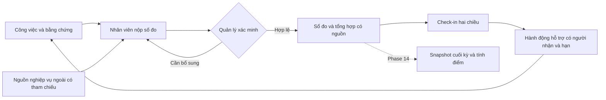

# Dự thảo hợp đồng Phase 12 — Sổ đo KPI và check-in định kỳ

Ngày **25/11/2026**, đối chiếu commit **`13fd9e3`**, schema **`20261125_0011`**. **Đề xuất để triển khai tiếp; chưa có trong runtime, chưa nghiệm thu.** [Kế hoạch task](superpowers/plans/2026-11-25-phase-12-measurements-checkins.md).

## 1. Kết quả và ranh giới

Phase 11 trả lời ai giao, ai làm và ai nghiệm thu công việc. Phase 12 bổ sung **con số được tạo từ đâu, ai xác minh, đang tiến triển ra sao và cần hỗ trợ gì tiếp**. Số đo đã xác minh là dữ kiện trong kỳ, chưa phải điểm cuối kỳ.

Không triển khai AI cố vấn (Phase 13), tính điểm/chốt/đóng CONTINUOUS (Phase 14), thay baseline/bàn giao/scheduler offline (Phase 15). Không dùng số task hoàn thành, tin nhắn hoặc thời gian online để tự chấm điểm. Không đổi `.env`, khóa AI, mật khẩu hay nạp lại dữ liệu chính.

## 2. Quyền và phân chia trách nhiệm

| Role | Số đo | Check-in | Không được làm |
| --- | --- | --- | --- |
| EMPLOYEE | Tạo/sửa nháp, nộp/nộp lại, đề nghị sửa hoặc rút số của chính mình; đọc nguồn của mình | Chuẩn bị, góp ý, xác nhận đã đọc biên bản; nhận hành động được giao | Tự xác minh; sửa số đã xác minh; xem đồng nghiệp |
| MANAGER hiện hành | Đọc/xác minh/trả lại/từ chối số của nhân viên trực tiếp; không sửa nội dung thay nhân viên | Lên lịch, phản hồi, chốt biên bản, giao/kiểm tra hành động trong cặp quản lý–nhân viên | Tự xác minh số của mình; duyệt ngoài nhóm; xác nhận biên bản hộ nhân viên |
| HR | Xem tình trạng đủ/thiếu, số bản chờ, số quá hạn và trường hợp cần điều phối | Xem lịch/trạng thái và số hành động mở/quá hạn, người cần phối hợp | Xem nội dung bằng chứng/biên bản riêng, duyệt số hoặc đóng hành động thay quản lý |
| ADMIN | Không có quyền nghiệp vụ | Không có quyền nghiệp vụ | Truy cập nguồn số, nội dung hay nút thao tác qua quyền quản trị |

Giữ scope hiện có của Phase 11: bản thân hoặc nhân viên trực tiếp, tài khoản/nhân sự còn hoạt động. Khóa bảo mật vẫn cho phép; hồ sơ cần HR xử lý, không tự chuyển người duyệt. Đối tượng ngoài scope trả 404; kiểm tra cả API danh sách, chi tiết, lịch sử, export/snapshot nếu có và deep link.

Quản lý có thể chịu trách nhiệm một hành động hỗ trợ, nhưng nhân viên phải xác nhận hoàn thành hành động đó; không tự đóng hành động mình sở hữu. Không thêm quyền xem chat riêng hoặc phản hồi 360 thô vào check-in.

## 3. Quy tắc đo gắn với baseline đã duyệt

- Mỗi `WorkGoal` của revision hiện hành có một `MetricRuleRevision` bất biến, giữ goal ID, revision kế hoạch, snapshot nguồn/đơn vị/cách đo và phiên bản thuật toán. Không tra lại danh mục KPI đang sửa để diễn giải số lịch sử.
- Các mã thực tế đã có là **`SUM`, `LAST`, `RATIO`, `MILESTONE`**. Không dùng tên DISTINCT_COUNT/LAST_VALUE của đề xuất tổng thể như thể runtime đã hỗ trợ chúng.
- Quy tắc Phase 12 v1 dùng **nguồn theo từng đối tượng/sự kiện**, không nhận các lô tuần/tháng chồng lấn. Với SUM/RATIO, mã nguồn phải đại diện một đối tượng nghiệp vụ trong phạm vi KPI; nộp theo lô có khoảng thời gian là ngoài phạm vi. Với LAST, mỗi lần đo là một snapshot tại thời điểm xác định.
- Dữ liệu kế hoạch Phase 11 thiếu metadata mới được diễn giải theo quy tắc tương thích được công bố này; không sửa JSON/revision cũ. Chỉ tạo rule cho kế hoạch APPROVED, đã nhận đúng bản và kỳ ACTIVE khi có thao tác ghi đầu tiên, trong giao dịch và có unique theo goal. Không tạo rule/snapshot do GET. Định nghĩa không tương thích đơn vị phải bị chặn với lý do, không tự đổi target.
- Milestone nhận ID ổn định từ `goal_id + vị trí trong danh sách bất biến`; tiêu đề không phải khóa. RATIO/MILESTONE v1 dùng đơn vị phần trăm (`%`, chuẩn hóa rõ khi kiểm tra), từ 0 đến 100; target của hai phương pháp không quá 100. Với kế hoạch mới, kiểm tra ngay trước duyệt/kích hoạt; với ACTIVE cũ không tương thích, báo cần xử lý baseline theo quy trình sau, không âm thầm sửa.

| Cách đo | Dữ liệu nộp | Tổng hợp các nguồn hiệu lực | Ví dụ có đáp án |
| --- | --- | --- | --- |
| SUM | Delta không âm, mã sự kiện/đối tượng duy nhất | Cộng delta; baseline chỉ để đối chiếu, không tự cộng vào actual | 20 + 35 + 50 = 105; đây phải là ba delta, không phải báo cáo lũy kế |
| LAST | Giá trị snapshot không âm, thời điểm đo | Chọn nguồn hợp lệ có `occurred_at` mới nhất; không lấy thời điểm duyệt | 20 → 35 → 50 cho actual 50 |
| RATIO | Tử và mẫu không âm, tử ≤ mẫu; không nhập % đơn lẻ | `100 × tổng tử / tổng mẫu` | 9/10 và 1/2 từ các đối tượng không trùng cho 83,3333…%, không phải 70% |
| MILESTONE | Một mốc trong baseline và bằng chứng đạt mốc | Cộng trọng số các mốc đã xác minh, mỗi mốc một lần | Mốc 30%, 70%; chỉ mốc đầu được xác minh thì actual 30% |

Mẫu RATIO trong kiểm thử hàm tổng hợp có thể biểu diễn nhóm nguồn; API không được dùng ví dụ đó để cho phép nộp lô chồng lấn. Ví dụ 30/40 và 90/100 phải tổng hợp ra 120/140 = 85,714285…%, không lấy trung bình hai tỷ lệ. Không có nguồn hợp lệ hoặc tổng mẫu bằng 0 → `actual=null`, **chưa đủ dữ liệu**. Một bản SUM/LAST giá trị 0 được xác minh là **có dữ liệu bằng 0**. Với MILESTONE, bản xác nhận bắt đầu/chưa đạt không được tự tạo mốc; chưa có mốc nào được xác minh hiển thị chưa có dữ liệu xác minh, không tự báo thất bại.

Input dùng Decimal hữu hạn, không âm, tối đa 4 chữ số thập phân và giới hạn tương thích Number của Phase 11; mẫu số 0 chỉ cho tử số 0. Tính tổng và tỷ lệ bằng số chính xác, không dùng float. Snapshot giữ tổng tử/mẫu hoặc giá trị hữu tỷ chính xác; hiển thị làm tròn HALF_UP (tỷ lệ 2 số, giá trị thường tối đa 4 số), không đưa số đã làm tròn vào công thức tính điểm tương lai. Tràn giới hạn lưu trữ phải trả lỗi và rollback, không cắt hoặc ép số.

## 4. Số đo, nguồn và chống trùng

Một `Measurement` là **một dòng nguồn ổn định** của một goal; `MeasurementRevision` là lần khai/nộp số của dòng đó. Mỗi revision có payload định lượng, loại nguồn, lý do, text/URL bằng chứng, `occurred_at`, author và thời điểm hệ thống. URL chỉ HTTP(S), không upload hay tự fetch.

Nguồn gồm:

1. **WORK:** đúng work item của cùng plan/goal; tham chiếu bản nộp và sự kiện nghiệm thu cụ thể. Có thể chuẩn bị nháp trước, chỉ được nộp khi việc ACCEPTED. Mã nghiệp vụ dùng `WorkItem.source_key`, không dùng UUID request để giả thành nguồn khác. Một việc v1 chỉ có một dòng số đo cho goal đã gắn; không gắn chéo goal hoặc đếm mỗi lần nộp bằng chứng thành một đóng góp.
2. **EXTERNAL_REFERENCE:** mã hồ sơ/sự kiện ngoài, ghi rõ nguồn và bằng chứng; quản lý xác nhận nội bộ. Không tuyên bố đã tích hợp/đối soát CRM hay biết chắc hồ sơ ngoài có thật.

Khóa nghiệp vụ là `(rule_revision_id, canonical_source_key)`, dùng chung hai loại nguồn để không vừa nhập ngoài vừa nhập từ việc cùng mã. Chuẩn hóa Unicode NFKC, trim và casefold theo một hàm versioned; giữ bản gốc để đọc. Không bỏ tùy tiện dấu câu/số 0 đầu mã. Chặn collision với dữ liệu cũ khi ghi, không đổi `source_key` cũ. Cùng mã ở goal của người khác vẫn có thể là cùng đầu ra: MVP chưa kiểm chứng phân chia công sức liên nhân viên, UI phải công bố giới hạn và quản lý chịu trách nhiệm kiểm tra; không quảng cáo chống trùng toàn công ty.

LAST còn chặn hai dòng cùng goal/thời điểm đo; sửa snapshot đó dùng revision cùng dòng. MILESTONE chỉ có một dòng ổn định cho mỗi `(rule, milestone_id)`; đổi bằng chứng là revision mới, không tạo mốc thứ hai. Mã nguồn/chủ thể/goal/thời điểm định danh nguồn không sửa sau gửi; nhập sai định danh phải đề nghị rút dòng cũ có lý do rồi tạo dòng đúng.

Không tự sinh số khi bấm **Nghiệm thu công việc**. UI có nút riêng **Lập số đo từ kết quả này**, điền nguồn và bằng chứng sẵn để nhân viên kiểm tra/nộp. Mọi nguồn đã nộp lại vẫn qua bước quản lý xác minh định lượng.

## 5. Trạng thái, sửa số và rút số

Luồng revision: `DRAFT → SUBMITTED → VERIFIED | RETURNED | REJECTED`. Nháp được sửa với version; payload đã SUBMITTED bất biến. RETURNED cho phép tạo revision mới; REJECTED kết thúc lần nộp và vẫn giữ lịch sử. Chỉ một revision chờ xử lý của cùng dòng tại một thời điểm.

- Sửa số VERIFIED là **đề nghị điều chỉnh** chứa giá trị thay thế toàn phần và lý do, không phải delta âm. Bản cũ vẫn hiệu lực khi bản mới đang chờ, bị trả hoặc từ chối. Khi bản mới VERIFIED, chuyển hiệu lực sang đúng bản mới trong cùng giao dịch; không cộng cả hai.
- Rút số VERIFIED dùng revision loại **VOID**, có lý do, nhân viên nộp và quản lý xác minh. VOID hiệu lực loại cả dòng khỏi tổng; không quay về giá trị cũ. Các revision trước vẫn đọc được.
- Quyết định xác minh/trả/từ chối, sửa hiệu lực, audit và thông báo được append vào lịch sử riêng; không UPDATE/DELETE nội dung bản đã gửi/đã duyệt. Projection trạng thái/phiên bản có thể cập nhật, nhưng phải rebuild được từ lịch sử.
- WORK được mở lại ở Phase 11 phải **đồng thời treo mọi đóng góp của nguồn đó** và cập nhật aggregate. Giữ nguyên giá trị đã lưu trong snapshot cũ; màn hiện hành ghi “Nguồn công việc đang được bổ sung”. Không rơi về revision cũ để tiếp tục tính. Nghiệm thu lại không tự khôi phục số: cần revision số đo mới tham chiếu lần nghiệm thu mới và xác minh lại.
- Kiểm tra tài khoản, scope, việc còn ACCEPTED, submission/accept event đúng lần và deadline tại lúc VERIFY. Hai tab verify/return, verify/reopen hay correction/void chỉ được có một kết quả hiệu lực theo version và thứ tự khóa.

`client_request_id` chống lặp theo actor và miền lệnh, hash bao gồm đối tượng, hành động và payload. Cùng khóa/nội dung trả kết quả lệnh đã ghi nhận mà không nhân event; cùng khóa khác nội dung trả 409. Retry vẫn kiểm tra phiên, CSRF và scope hiện hành; idempotency không cấp quyền cũ cho người đã mất quyền.

## 6. Thời gian, tổng hợp và truy xuất

`occurred_at` là thời điểm nghiệp vụ nằm trong `[đầu ngày bắt đầu, đầu ngày sau kết thúc)` theo múi giờ kỳ, không ở tương lai. `submitted_at`, `verified_at` và thời điểm event do server đặt. Nháp/nộp/nộp lại/đề nghị sửa hoặc rút chỉ trước hoặc đúng `input_cutoff_at`; xác minh/trả/từ chối chỉ trước hoặc đúng `verification_due_at`. Qua hạn trả lỗi `workflow_cutoff`; không sửa đồng hồ hoặc tự gia hạn.

Bản bị trả sau cutoff không được nộp lại qua cửa sau; hiện rõ đang chờ xử lý cuối kỳ ở Phase 14. Không xóa bản đó hoặc tự coi là 0. Kỳ phải CONTINUOUS ACTIVE, kế hoạch hợp lệ và chưa có khóa cuối kỳ; các API tính/chốt/đóng cũ tiếp tục bị chặn.

Mỗi thay đổi hiệu lực (VERIFY, VOID được duyệt, treo nguồn do reopen) tăng `measurement_version` của plan và sinh snapshot aggregate đồng bộ trong giao dịch. Nháp, trao đổi, đọc thông báo hay check-in không tăng version số liệu. Snapshot chứa rule/goal/plan revision, phiên bản thuật toán, cửa sổ sự kiện, `known_at`, version dữ liệu, danh sách revision/event nguồn có hash, tử/mẫu hoặc số chính xác và trạng thái thiếu dữ liệu. Không nhét text bằng chứng vào thông báo/audit metadata.

Khi tái dựng một mốc cũ, chỉ lấy quyết định/sự kiện đã được hệ thống ghi nhận không sau `known_at` và version đã ghim, rồi xét thời điểm nghiệp vụ của nguồn. Không dùng cờ hiệu lực hiện hành để giả lập quá khứ: một số đo xảy ra tuần trước nhưng mới được duyệt hôm nay không được xuất hiện trong snapshot “đã biết” của tuần trước. Phiên bản tăng đơn điệu giải quyết thứ tự khi timestamp bằng nhau.

- **Hiện hành:** dùng hiệu lực mới nhất; số đang chờ hiển thị riêng theo từng bản, không cộng lẫn với số xác minh.
- **Theo thời gian:** nhóm theo `occurred_at` và múi giờ kỳ. SUM/RATIO dùng nguồn thuộc khoảng chọn; LAST chọn snapshot gần nhất không sau cuối khoảng; MILESTONE là lũy kế các mốc đạt đến mốc chọn. Label phải nói rõ lũy kế hay phát sinh trong khoảng.
- **Đã biết tại lần check-in:** dùng snapshot/version đã ghim; sửa hoặc treo nguồn hôm nay không viết lại biên bản tuần trước. Có thể đối chiếu với số hiện hành và chỉ rõ đã thay đổi.

Không ghi các actual này vào `EmployeeKPI.actual` của LEGACY. Thêm API tiến trình riêng; không mở adapter tính điểm hoặc thay `ENGINE_VERSION` ở phase này. Không gọi aggregate là “kết quả cuối kỳ” hay trình bày % hoàn thành target tuyến tính khi chưa có đường kỳ vọng được thống nhất.

## 7. Check-in hai chiều và hành động hỗ trợ

Mỗi cuộc check-in thuộc một plan, một cặp quản lý–nhân viên, có khoảng rà soát trong ngày kỳ và lịch hẹn trước hạn xác minh. Quản lý lên lịch cụ thể; UI gợi ý lần kế tiếp sau 7/14 ngày, chỉ tạo sau xác nhận. Không sửa lịch kỳ/baseline để có lịch check-in, không sinh hàng loạt cuộc họp trong GET hay khi mở trang.

Trạng thái: `SCHEDULED → OPEN → PUBLISHED`; quản lý có thể `CANCELLED` trước công bố với lý do. Đổi lịch trước công bố có lý do, lịch cũ được giữ; sau công bố không ghi đè. Nhân viên và quản lý lưu phần chuẩn bị riêng, chia sẻ rõ trước cuộc họp; draft riêng không lộ cho bên kia/HR. Phạm vi phase này chỉ hai người, chưa mời tùy ý người thứ ba.

1. Nhân viên chuẩn bị: đã làm, vướng mắc, cần hỗ trợ gì; không bắt nhập lại số hệ thống đã có.
2. Quản lý xem số hiện hành có nguồn, bản chờ xác minh và công việc bị chặn; xác minh số ở luồng số đo, không duyệt ngầm bằng thao tác chốt biên bản.
3. Hai bên trao đổi; quản lý công bố biên bản gồm nhận xét, điểm chưa thống nhất và hành động hỗ trợ. Ghim snapshot số đo hiện có tại công bố; nếu chưa có dữ liệu thì ghim trạng thái “chưa đủ dữ liệu”, không tạo số 0.
4. Nhân viên **Xác nhận đã đọc** hoặc **Yêu cầu làm rõ**. Đây không phải đồng ý đánh giá. Yêu cầu được quản lý phản hồi bằng phụ lục bất biến và nhân viên đọc/xác nhận phụ lục; không sửa bản công bố gốc. Không ép đồng thuận hoặc tự đóng câu hỏi chỉ vì hết giờ.

Hành động có nội dung/đầu ra, owner là một trong hai người, due date không sau hạn xác minh và reviewer là người còn lại. Tạo khi công bố hoặc phụ lục có lý do. `OPEN → IN_PROGRESS → SUBMITTED → DONE`; reviewer trả `CHANGES_REQUESTED`, owner bổ sung; quản lý có thể CANCELLED trước DONE có lý do, không sửa bản ghi đã DONE. Thay nội dung/owner/hạn: hủy có lý do và tạo hành động thay thế có liên kết, không lùi hạn ngầm. Báo tiến độ/nộp/kiểm tra chỉ đến hạn xác minh; qua hạn vẫn đọc và hiện cần xử lý, chưa tự đóng. Hành động không tự tạo work item/KPI contribution; nếu cần giao việc chính thức, tạo work item bằng luồng Phase 11 và liên kết nguồn, không chép thành hai kết quả.

Check-in qua hạn mà chưa công bố và hành động qua due date là cờ suy ra, không phải điểm trừ hoặc bằng chứng nhân viên có lỗi. Ghi rõ ai đang giữ bước. HR chỉ thấy metadata điều phối, không đọc nội dung hai bên.

## 8. Giao diện dùng lại và thông báo

Giữ header/sidebar theo role. Trong trang **Công việc & mục tiêu** hiện có, chốt bốn tab cấp trang: **Công việc / Kế hoạch & mục tiêu / Số đo KPI / Check-in**. Hành động nằm ở đúng tab, không sao chép bộ nút soạn/duyệt đi khắp trang. HR dùng trang chu kỳ → tình trạng tiến trình, không nhận các tab thực hiện.

- **Số đo KPI:** ưu tiên danh sách KPI với target, số xác minh, tình trạng dữ liệu và nút “Xem nguồn”; nhân viên thấy cần nộp/cần bổ sung, quản lý thấy chờ xác minh. Chỉ hiện form đúng phương pháp và quyền. Biểu đồ tùy chọn sau bảng nguồn, không dựng đường mục tiêu giả.
- **Chi tiết số đo:** modal dùng lại `WorkspaceDialog`, tab **Nội dung / Bằng chứng / Lịch sử**; chỉ rõ số cũ và số đề nghị thay, ai cần duyệt. Không biến modal công việc thành form số đo có thêm bộ tab lồng nhau; chuyển nội dung modal có breadcrumb/trở lại nội bộ, một lớp nổi tại một thời điểm.
- **Check-in:** danh sách lịch sắp tới/chưa đọc/cần làm rõ và hành động; modal **Chuẩn bị / Biên bản / Hành động / Lịch sử**. Biên bản được công bố và draft riêng phải phân biệt rõ.
- Giữ draft/filter/vị trí khi đóng hoặc lỗi, X/Escape/focus, review trước quyết định, cảnh báo nội dung chưa lưu, conflict có tải trạng thái mới mà giữ bản nhập. 390px không tràn ngang; desktop ưu tiên nội dung chính, panel chi tiết có độ rộng phù hợp.

Thông báo đúng người cho submit/return/verify/reject số, treo nguồn, lịch/đổi lịch, công bố/làm rõ/phụ lục, giao/nộp/trả/hoàn thành hành động. Không gửi mỗi lần gõ/lưu draft. Thêm target typed cho số đo/check-in/action; API giải quyền lại khi mở. Dùng cùng SSE hiện có, commit-only invalidation và fallback, không thêm socket. “Đã đọc” và “đã hoàn thành” là hai trạng thái khác nhau. Nhắc quá hạn trong danh sách là read-derived; chưa quảng cáo thông báo offline.

## 9. Các bất biến phải kiểm chứng

Khóa theo quy ước đã có: tổ chức → ADMIN/user có liên quan theo ID → phiên → cycle → participant → plan → work (nếu có) → dòng số đo/check-in/action theo thứ tự ổn định. Mọi writer cùng plan cùng dùng plan lock, không khóa measurement trước rồi quay lại khóa work hoặc user. Giữ giao dịch ngắn, không gọi dịch vụ ngoài. Thay đổi trạng thái, lịch sử, tổng hợp, audit và thông báo cùng commit/rollback.

Kiểm thử bắt buộc: ranh giới quyền/giả UUID/CSRF/role đổi; replay; hai lệnh cạnh tranh; verify với work reopen; sửa/VOID/milestone trùng; Decimal/zero/múi giờ/cutoff; snapshot lịch sử không đổi; lỗi lưu aggregate/audit/notification rollback; DB constraints/immutability và fresh/upgrade có dữ liệu. Thử full form bằng hai tài khoản, HR chỉ thấy metadata và ADMIN không có UI/quyền. Không dùng kết quả test Phase 11 để tuyên bố Phase 12 đã đạt.
