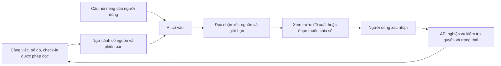

# Dự thảo Phase 13 — Cố vấn AI trong quá trình làm việc

Ngày **25/11/2026**. Baseline **`2f2e29d`**, schema **`20261125_0012`**. **Đây là thiết kế để xem xét; chưa triển khai, chưa nghiệm thu Phase 13.** Xem [kế hoạch triển khai](superpowers/plans/2026-11-25-phase-13-contextual-ai-coaching.md) và [kết quả Phase 12](phase-12-report.vi.md).

## 1. AI giúp việc gì?

Phase 11 cung cấp công việc/bằng chứng; Phase 12 cung cấp số đo xác minh và check-in. Phase 13 giúp người dùng **hiểu tình hình, hỏi cách xử lý vướng mắc, chuẩn bị trao đổi và chọn hành động tiếp theo ngay trong kỳ**, khi chưa có điểm cuối kỳ.

Ví dụ: Huy đang chờ dữ liệu QA từ đối tác. Huy hỏi cách tiếp tục; AI chỉ ra công việc bị chặn và số liệu còn chờ, gợi ý câu hỏi cần làm rõ. Huy chọn một đoạn gửi vào trao đổi công việc. Mai Anh nhận thông báo, hỏi AI riêng cách hỗ trợ và chuẩn bị check-in. Hai người thống nhất hành động; việc hoàn thành và số đo sau đó vẫn được xác nhận qua Phase 11–12.

AI không nghiệm thu, xác minh số, sửa KPI, đổi hạn, giao hỗ trợ hay chốt điểm thay con người. Không dùng kết quả AI để tự xếp hạng, đánh giá nhân cách hoặc quyết định nhân sự. Điểm/chốt CONTINUOUS thuộc Phase 14; bàn giao/baseline/scheduler thuộc Phase 15.

## 2. Phạm vi và quyền

| Người dùng | Được hỏi | Nguồn được dùng | Riêng tư |
| --- | --- | --- | --- |
| Nhân viên | Kế hoạch, việc, số liệu và check-in của mình | Dữ liệu bản thân đang được đọc trong workflow | Chỉ chủ hội thoại đọc; quản lý/HR không tự thấy |
| Quản lý trực tiếp | Từng người hiện đang trực tiếp quản lý | Các nguồn nghiệp vụ được quyền đọc của người đó | Hội thoại riêng của quản lý; không đọc hội thoại nhân viên |
| HR | Điều phối một kỳ CONTINUOUS | Metadata đếm/chờ/quá hạn/khâu cần xử lý theo quyền HR | Hội thoại riêng của người HR tạo; không đọc hội thoại của HR khác |
| ADMIN | Không có chức năng cố vấn nghiệp vụ mặc định | Không có | Không có quyền đọc để quản trị kỹ thuật |

Mỗi thread cố định `owner_id`, `audience`, chu kỳ và anchor. Audience do server suy ra: `EMPLOYEE_PRIVATE`, `MANAGER_PRIVATE`, `HR_COORDINATION_PRIVATE`; không dùng audience `HR_PRIVATE` của báo cáo AI cũ. Anchor là PLAN/WORK/CHECKIN thuộc cùng kế hoạch, hoặc CYCLE cho HR. Không đổi thread từ nhân viên này sang người khác, từ riêng sang chung hoặc từ HR sang nhân viên.

Quyền được kiểm tra ở danh sách, chi tiết, mỗi lượt hỏi, đọc lại, mở nguồn, chia sẻ và xác nhận đề xuất. Khi tài khoản/phiên bị thu hồi hoặc mất quan hệ quản lý, thread/nguồn không còn được truy cập bằng UUID đã biết; không trả lại nội dung từ cache. Tài khoản khác không được đọc thread dù cùng role hoặc cùng nhân viên được đánh giá. HR tiếp tục chỉ tổ chức/điều phối, không trở thành người đánh giá cá nhân. Thu hồi quyền không thu hồi được dữ liệu đã gửi tới provider trước đó; vì vậy phải giảm dữ liệu ngay khi dựng context và lưu dấu lần gửi.

## 3. Dữ liệu đưa vào ngữ cảnh

| Đưa vào theo quyền | Không tự đưa vào |
| --- | --- |
| Revision kế hoạch, tiêu chuẩn, cách đo và target đang áp dụng | Hồ sơ nhân sự đầy đủ, tên/email/mã nhân viên không cần thiết, credentials |
| Trạng thái việc, hạn, vướng mắc, bản nộp/bằng chứng được phép đọc | Toàn bộ chat người–người, bảng tin hoặc dữ liệu của người ngoài scope |
| Actual xác minh, nguồn hiệu lực, số đang chờ/trả/treo, lịch sử liên quan | Tự cộng số đang chờ vào actual; coi thiếu số là 0 |
| Biên bản/phụ lục đã công bố, hành động hỗ trợ và chuẩn bị đã chia sẻ còn được phép đọc | Chuẩn bị riêng chưa chia sẻ, kể cả của chính người hỏi, hoặc hội thoại riêng khác |
| HR: số lượng theo trạng thái/hạn, mức sẵn sàng và vấn đề tổ chức cần xử lý | Giá trị KPI cá nhân, bằng chứng, biên bản riêng, phản hồi 360 gốc, phân tích HR_PRIVATE cũ |

Chính câu hỏi và các lượt trước mà người dùng chủ động gửi là nội dung riêng của họ, không phải dữ kiện đã xác minh. UI cho biết phần này sẽ gửi tới Gemini; hạn chế định danh và nhắc xem lại dữ liệu nhạy cảm trong ô nhập. Không hứa bộ lọc loại được mọi thông tin nhạy cảm trong văn bản tự do.

Đọc ngữ cảnh trong một snapshot DB nhất quán, rồi đóng transaction trước gọi provider. Dùng lại query/phân quyền và phép tổng hợp của Phase 11–12; không lấy response riêng đầy đủ rồi chỉ giấu trường ở frontend. Không tự tạo `ProgressSnapshot` khi GET hoặc hỏi AI. Nếu chưa có snapshot lưu sẵn, dùng kết quả tính từ nguồn hiện hành và giữ manifest riêng trong `CoachingContext`.

Mỗi nguồn có alias nội bộ như `S1`, loại, ID/version chính xác, thời điểm và nhãn quyền. Alias được ánh xạ sang link nội bộ bởi server, không dùng URL do AI tạo. Lưu cả tập lựa chọn nguồn, tổng số/những phần bị cắt, tham số khoảng ngày, hash và version builder/prompt/schema. Nguồn đã được tóm tắt thành số vẫn giữ tham chiếu rule/snapshot/revision để truy vết.

Giới hạn khởi đầu: câu hỏi tối đa 4.000 ký tự; tối đa sáu cặp hỏi–đáp thành công gần nhất cùng scope; tối đa 40 tham chiếu và 48.000 byte cho toàn payload đã chuẩn hóa. Ưu tiên anchor người dùng chọn, việc bị chặn/quá hạn, số đang chờ, hai check-in gần nhất và hành động mở. Dữ liệu vượt giới hạn được chọn theo quy tắc ổn định và ghi rõ **ngữ cảnh có giới hạn**, không cắt âm thầm hoặc tự tạo bản tóm tắt AI khác. Task 0 phải chốt từng hạn mức truy vấn trước code và kiểm tra với fixture 60 người/1.000 nguồn.

## 4. Nhận xét phải phân biệt dữ kiện và suy đoán

- Số học do code hiện có cung cấp: actual, target, đơn vị, backlog, hạn và trạng thái. AI không tính lại SUM/RATIO, suy ra điểm hiệu suất hoặc biến tiến độ tự khai thành số xác minh.
- Khi chưa có mốc kỳ vọng theo thời gian, không tự chia target cho số ngày rồi kết luận “chậm X%” hoặc dự đoán chắc chắn cuối kỳ. Nêu số đang có, phần còn thiếu và câu hỏi cần làm rõ.
- Output dự kiến: `answer`, `observations[{text, source_ids}]`, `hypotheses`, `clarifying_questions`, `suggestions`, `limitations`. Nhận xét về dữ kiện phải có nguồn thuộc manifest; giả thuyết/gợi ý được ghi rõ là tham khảo. Hiển thị bảng dữ kiện định lượng do server tạo bên cạnh câu trả lời.
- Schema nghiêm ngặt, giới hạn chiều dài/số mục; cấm field/action/ID ngoài allowlist, kiểm tra cả fake provider. Nguồn không tồn tại hoặc không đúng scope không được tạo link hay hành động.
- Một citation hợp lệ không tự chứng minh diễn giải đúng. Bổ sung bộ tình huống/rubric kiểm tra nhận xét bịa nguyên nhân, số liệu sai, thiếu bằng chứng và thiên kiến. Nội dung nguồn/câu hỏi là dữ liệu không đáng tin, không được thay system instruction; provider không có tools, duyệt web hay quyền chạy code/URL.

Phân tích sau kỳ hiện có tiếp tục dùng `AnalysisOutput` sáu trường. Coaching có schema/provider contract riêng; dùng lại cách cấu hình, quản lý client, timeout và lọc lỗi của adapter Gemini, không ép output mới vào bảng `ai_analyses` có FK bắt buộc tới review.

## 5. Mỗi lượt hỏi là một lần thực thi có kiểm soát

1. **Reserve:** xác thực role/session/Origin/CSRF, scope và version thread; chống lặp theo `(actor_id, client_request_id)` và fingerprint; dựng ngữ cảnh, lưu câu hỏi/manifest, lease/fence và hạn mức trong giao dịch ngắn.
2. **Generate:** nhả toàn bộ connection/khóa DB; gọi Gemini một lần với deadline hiện có, lịch sử do server chọn, tools tắt. Giữ SDK/model/key cấu hình hiện hành; không tự đổi model, bật AI hoặc nâng SDK theo ví dụ mới trên web.
3. **Complete:** khóa theo thứ tự thống nhất, kiểm tra lại tài khoản/session/quyền, lease/fence và nguồn; validate output rồi ghi kết quả/audit trong một giao dịch. Lượt đã hết lease hoặc bị thay thế không được ghi đè lượt sau. Thay đổi quyền làm kết quả bị giữ lại và đánh dấu thất bại, không trả nội dung cho người đã mất quyền.

Trạng thái attempt: `RUNNING → SUCCEEDED | FAILED`. Tình trạng nguồn là chiều riêng: `CURRENT | STALE | RESTRICTED`. Nguồn đổi trong lúc gọi nhưng vẫn có quyền đọc: lưu lời khuyên với nhãn thời điểm cũ, không cho áp dụng/chia sẻ trước khi hỏi lại từ nguồn mới. Nguồn mất quyền đọc: che câu trả lời/ngữ cảnh phụ thuộc nguồn đó và không đưa lượt này vào lần gọi sau. Không lấy riêng `measurement_version` làm dấu vết cho toàn bộ work/check-in; so manifest/phiên bản/tập nguồn liên quan bằng cùng selector.

Giới hạn ban đầu: một lượt RUNNING mỗi tài khoản, tối đa bốn lượt RUNNING toàn coaching; cooldown 10 giây, tối đa năm lượt được reserve/10 phút và 50 lượt/ngày UTC mỗi tài khoản. Counter/lease dùng DB và cập nhật nguyên tử giữa replica, không dùng biến trong process. Replay không gọi provider hoặc tăng counter lần nữa. Các con số là giới hạn số request dự kiến, không phải bảo đảm một mức tiền hay số token chính xác. Task 0 kiểm tra khả năng cấu hình và thông điệp giới hạn trước khi triển khai.

Tắt cấu hình AI trả trạng thái rõ ràng, không giả thành lời khuyên thật. Timeout/quota/output lỗi giữ câu hỏi và câu trả lời cũ; retry cần thao tác riêng, UUID mới, liên kết attempt cũ và version mới nhất. Request mạng gửi lại cùng UUID chỉ đọc trạng thái/kết quả cũ. Không retry SDK tự động, không gọi từ GET/SSE/tải trang/scheduler. Không bảo đảm billing bên ngoài đúng một lần nếu phản hồi mạng bị mất.

MVP trả kết quả hoàn chỉnh, chưa stream token và chưa thêm worker/queue/vector DB. GET/poll chỉ đọc, kể cả lease đã hết; một lệnh reserve tiếp theo xử lý lease cũ bằng giao dịch có audit. Rời panel không có nghĩa lượt đã gửi được hủy miễn phí. Audit/log chung chỉ lưu ID, loại sự kiện, version, mã lỗi và số liệu vận hành; prompt/câu hỏi/output nằm trong storage riêng được phân quyền.

## 6. Chia sẻ và sử dụng gợi ý

MVP có ba đường ra được kiểm soát:

| Chọn trên UI | Sau bước xem trước và xác nhận |
| --- | --- |
| Dùng gợi ý soạn công việc | Mở form việc sẵn có, điền tiêu đề/đầu ra; người dùng chọn mã nguồn, goal và hạn hợp lệ. Nhân viên tạo `PROPOSED`; quản lý tạo `TODO` theo nghiệp vụ hiện có, UI nói rõ việc sẽ được giao/thông báo |
| Dùng gợi ý chuẩn bị check-in | Chọn check-in SCHEDULED/OPEN cùng plan, xem toàn bộ phần ghép với bản riêng hiện có; lưu `shared=false`. Nếu phần hiện có đã chia sẻ thì chuyển sang form Check-in thông thường, không âm thầm chuyển về riêng hoặc ghi đè |
| Chia sẻ đoạn AI vào trao đổi công việc | Chọn các khối câu trả lời và đúng work item cùng plan, xem nguyên văn đoạn gửi/nguồn/người nhận, xác nhận tạo comment có nhãn lời khuyên AI |

HR_COORDINATION_PRIVATE không có các nút tạo/chia sẻ tới hồ sơ cá nhân. Không chia sẻ toàn bộ thread, không dùng model để tự đổi audience PRIVATE thành PUBLIC. Đoạn được chọn là quyết định tiết lộ của chủ hội thoại: preview phải đầy đủ, kiểm tra lại nguồn mà người nhận được đọc, không tuyên bố có DLP hoàn hảo. Người nhận chỉ đọc excerpt/nguồn được phép, không được link ngược vào thread riêng. Bình luận riêng của người gửi tách khỏi nguyên văn đoạn AI.

Đề xuất từ model chỉ là nội dung để soạn. Server tạo `proposal_id`/preview version có ràng buộc loại, owner, anchor, nguồn, payload hash, đích và hạn hiệu lực; model không tự cung cấp route, assignee hoặc UUID đáng tin. Người dùng sửa form làm preview trước hết hiệu lực và phải xem lại. Khi xác nhận phải kiểm tra cả version hiện tại của kế hoạch/việc/check-in/phần chuẩn bị, quyền và deadline bằng domain service hiện có.

Tạo bản ghi nghiệp vụ, receipt nối turn → đề xuất/đoạn chia sẻ → entity, audit và thông báo phải cùng một transaction. Replay trả cùng kết quả, không tạo hai việc/comment. Task tích hợp phải tách helper giao dịch tối thiểu trong service hiện có nếu cần; không bọc `session.begin()` ngoài service đang tự begin/commit và không sao chép state machine sang module coaching. Lỗi sau tạo entity phải rollback cả entity và receipt. Câu trả lời chưa dùng không được ghi nhận là người dùng đã thực hiện gợi ý.

Không tự áp dụng thay đổi hạn, tạo hành động hỗ trợ, nghiệm thu hay sửa số từ AI. Các quyết định này vẫn thao tác tại Công việc/Check-in/Số đo KPI và chịu đầy đủ quyền/quy tắc của Phase 11–12.

## 7. UI sử dụng hằng ngày

Tái dùng trang công việc, bốn tab và modal hiện có. Thêm nút **Hỏi cố vấn AI** theo đối tượng đang xem; HR đặt trong Điều phối tiến trình. Panel có tên người/ngữ cảnh ở lớp UI nội bộ, nhãn **Riêng tư**, thời điểm dữ liệu, câu hỏi gợi ý và ba phần: **Trao đổi / Nguồn / Lượt trước**. ADMIN không thấy nút.

Desktop mở panel bên phải; mobile dùng khung phủ có nút ×/Escape và quản lý focus. Không xếp panel thông báo, chat nội bộ và AI thành nhiều lớp chồng nhau. Khi cần xem form nghiệp vụ, chuyển cùng một lớp hiển thị và giữ câu hỏi/draft/bộ lọc; đóng form quay lại đúng ngữ cảnh, không bắt Back browser. Việc chuyển người phải đổi thread, có cảnh báo bản chưa gửi.

Không tự gửi câu hỏi khi bấm gợi ý; người dùng xem ngữ cảnh rồi bấm **Gửi câu hỏi**. Chỉ xem lịch sử/nguồn không gọi Gemini. Có trạng thái chưa cấu hình, đang trả lời, dữ liệu cũ, nguồn mất quyền, quota/lỗi và thử lại rõ ràng. Không nhồi chat AI thành tab chính thứ năm hoặc trộn với cửa sổ nhắn tin người–người.

## 8. Dữ liệu/API dự kiến và ranh giới triển khai

Module riêng `app/modules/coaching`, feature web `features/coaching`. Migration dự kiến **`20261125_0013`** nối `0012`, chỉ chốt số revision sau khi kiểm tra head lúc bắt đầu code.

| Bảng dự kiến | Vai trò/ràng buộc chính |
| --- | --- |
| `coaching_threads` | Owner/audience/anchor bất biến, version; FK cùng cycle/plan, HR cycle-only |
| `coaching_turns` | Thứ tự theo thread, question bất biến, UUID/fingerprint, status/lease/fence, output/model/version/thời điểm; partial unique RUNNING theo actor |
| `coaching_contexts` | Payload đã giảm định danh, manifest/hash/builder version bất biến, FK đúng turn; không có API đọc vượt scope |
| `coaching_handoffs` | Preview/proposal, excerpt/receipt đã xác nhận và typed FK tới work/preparation/event; chống lặp và ràng buộc cùng plan, lịch sử bất biến |
| `coaching_usage_buckets` | Counter bền vững theo account/window và điều phối giới hạn toàn coaching; cleanup có giới hạn, không xóa lịch sử nghiệp vụ |

Nhóm API dưới `/api/v1/coaching`: `GET/POST /threads`, `GET /threads/{id}`, `POST /threads/{id}/turns`, `GET /turns/{id}`, `GET /turns/{id}/sources?page=`, `POST /turns/{id}/handoffs/preview`, `POST /handoffs/{id}/confirm`. Đây là tên dự kiến, không phải endpoint hiện có. Lịch sử/nguồn phân trang, scope trước pagination; chỉ ghi khi có lệnh rõ ràng. Lệnh có expected version, UUID, Origin/CSRF; các lỗi scope/version/quota/provider không trả stack/raw response hay secret.

Giữ AI báo cáo cũ và tất cả dữ liệu LEGACY/CONTINUOUS Phase 11–12; không backfill hội thoại giả, seed vào DB chính hoặc tự thay `.env`. Mất Gemini không ngăn giao việc, xác minh số, check-in hoặc các luồng tính điểm LEGACY.

## 9. Tài liệu kỹ thuật và điều kiện nghiệm thu

Đã đối chiếu `AIService.reserve/complete`, adapter `GeminiProvider`, schema `AnalysisOutput`, `authorize_domain_write`, `WorkRepository`, `WorkService.create_work/action` và `CheckinService.prepare` của baseline. Provider hiện dùng `generate_content`, schema JSON, deadline và một lần thử SDK; cần test adapter coaching mới với chính SDK đang khóa **google-genai 2.32.0**, không mặc định copy API mới từ tài liệu online.

Google mô tả khả năng [hội thoại nhiều lượt](https://ai.google.dev/gemini-api/docs/text-generation) và [output theo JSON Schema](https://ai.google.dev/gemini-api/docs/structured-output). Đây là tham khảo khả năng provider, không xác nhận model cấu hình hiện tại đã chạy được coaching. Thiết kế cho InsightHR vẫn tự chọn/lưu lịch sử theo quyền và validate schema/nguồn phía server.

Nghiệm thu bằng fake provider/MockTransport trước; demo riêng có dữ liệu hư cấu và không gọi Gemini khi seed. Một lượt Gemini thật, nếu tiến hành, phải tách khỏi test offline, dùng cấu hình người vận hành đã cho phép và ghi model/thời điểm/số request thực tế; thất bại phải ghi đúng lỗi, không coi fake output là kết quả thật. Không tạo báo cáo “hoàn thành Phase 13” trước khi các gate trong kế hoạch đạt.
