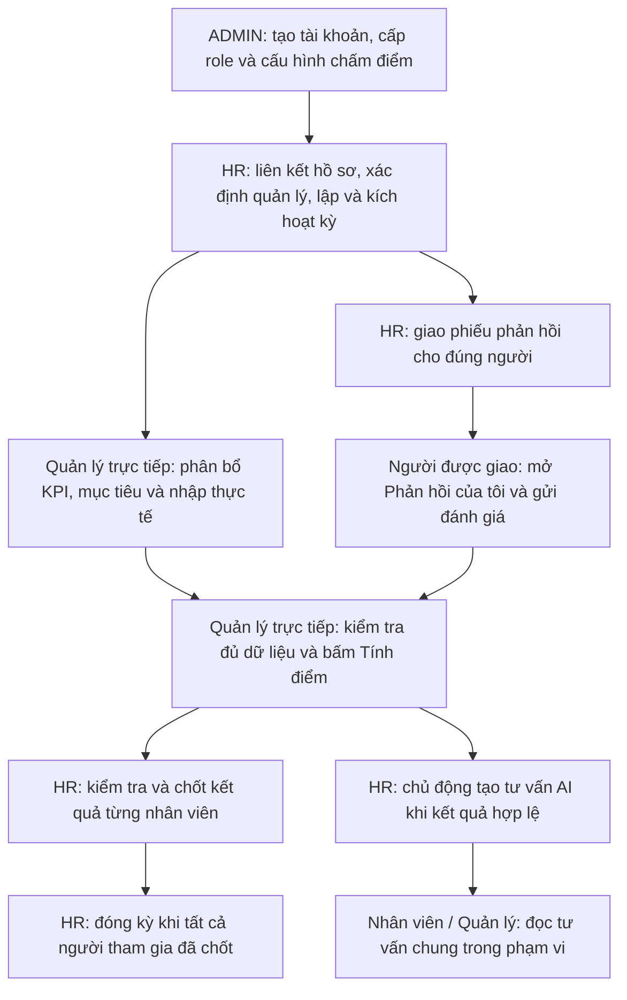

# Ai làm gì trong InsightHR? Vai trò, nhiệm vụ và cách phối hợp

Xem [bản đồ giao diện theo role](giao-dien-theo-role.vi.md) để biết chính xác từng nhóm menu có gì. Hồ sơ đánh giá mở trong khung nổi, dùng ba tab nội bộ và nút **× Đóng** để quay về danh sách.

Tài liệu này giải thích **cách hệ thống vận hành**. Khi đã hiểu, dùng [bài nghiệm thu từng bước](nghiem-thu.vi.md) để thao tác trên dữ liệu demo.

## 1. Dự án giải quyết việc gì?

InsightHR tổ chức một đợt **đánh giá hiệu suất nhân viên**: xác định ai được đánh giá, giao chỉ tiêu, thu thập kết quả công việc và phản hồi, tính điểm, chốt kết quả, rồi cung cấp tư vấn AI tham khảo.

Một hồ sơ đánh giá luôn gắn với **một nhân viên + một chu kỳ**. Ví dụ “Bình trong kỳ đánh giá tháng 11” khác với “Bình trong kỳ tháng 10”. Mỗi hồ sơ có KPI, phản hồi, các lần tính điểm và tư vấn riêng theo ngữ cảnh đó.

Luồng phối hợp chính:



AI cũng có thể được tạo sau khi chốt hoặc đóng kỳ. Sơ đồ đặt nhánh AI ở kết quả tính điểm để thể hiện AI dùng kết quả đã có; không cần AI thành công mới chốt/đóng được.

## 2. Phân biệt ba thứ để không bị rối

| Khái niệm | Nó quyết định điều gì? | Ví dụ |
| --- | --- | --- |
| **Tài khoản và role** | Người đăng nhập được dùng chức năng nào | Tài khoản Nguyễn Lan có role MANAGER |
| **Hồ sơ nhân viên và quan hệ quản lý** | Đang quản lý ai, được xem hồ sơ nào | Bình có quản lý trực tiếp là Nguyễn Lan |
| **Phân công phản hồi** | Ai phải gửi một phiếu đánh giá cho ai trong kỳ nào | Linh được HR giao đánh giá đồng nghiệp Bình |

**Tạo tài khoản chưa tự tạo hồ sơ nhân viên.** ADMIN tạo tài khoản; HR tạo hoặc sửa hồ sơ để liên kết tài khoản đó, đặt phòng ban/chức danh và quản lý. Nhân viên cũng phải được HR thêm vào chu kỳ thì mới có hồ sơ đánh giá của kỳ đó.

**Role khác quan hệ phản hồi.** `EMPLOYEE` là role; `SELF` (tự đánh giá), `MANAGER` (quản lý đánh giá), `PEER` (đồng nghiệp), `SUBORDINATE` (cấp dưới) là quan hệ trên từng phiếu. Người có role nào cũng chỉ gửi phiếu khi chính họ được phân công và đủ điều kiện. Có phiếu đánh giá người khác không đồng nghĩa được xem toàn bộ hồ sơ của người đó.

## 3. ADMIN — chuẩn bị quyền truy cập và cấu hình

**Trách nhiệm:** bảo đảm đúng người có tài khoản và đúng quyền; quản lý cấu hình chấm điểm mặc định.

| Việc ADMIN làm | Thao tác ở đâu? | Kết quả thể hiện trong hệ thống | Ai dùng tiếp? |
| --- | --- | --- | --- |
| Tạo tài khoản HR, quản lý, nhân viên | **Quản trị hệ thống → Quản lý tài khoản → Tạo tài khoản** | Email mới có role và trạng thái hoạt động | Người dùng đăng nhập; HR liên kết với hồ sơ nếu cần |
| Đổi role | Danh sách tài khoản → ô chọn vai trò | Quyền truy cập thay đổi theo role mới | Người dùng thấy chức năng được phép |
| Khóa/mở tài khoản | **Vô hiệu hóa / Kích hoạt** | Tài khoản bị khóa không tiếp tục sử dụng phiên được bảo vệ | HR có thể cần xử lý phân công còn chờ của người bị khóa |
| Đặt trọng số KPI/phản hồi và giới hạn điểm KPI | **Cấu hình chấm điểm** | Cấu hình mặc định được lưu | HR nhìn thấy cấu hình dự kiến khi chuẩn bị kỳ nháp |

Cấu hình được sao chép vào kỳ khi HR kích hoạt. Đổi mặc định sau đó áp dụng cho các lần kích hoạt tiếp theo, không tự thay điểm kỳ đang chạy.

**Giới hạn:** ADMIN không tự có quyền nhân sự. ADMIN không phải người giao KPI, đọc toàn bộ báo cáo nhân viên, chốt kết quả hoặc tạo AI. Tổng quan của ADMIN tập trung vào tài khoản.

Ví dụ: ADMIN tạo tài khoản cho Bình với role EMPLOYEE; HR mới là người gắn tài khoản đó vào hồ sơ Bình và đưa Bình vào đợt đánh giá.

## 4. HR — điều phối toàn bộ đợt đánh giá

**Trách nhiệm:** chuẩn bị danh sách, tổ chức thu thập bằng chứng, kiểm tra và xác nhận kết quả cuối cùng.

| Giai đoạn | HR làm gì? | Màn hình/nút | Người tiếp nhận hoặc kết quả |
| --- | --- | --- | --- |
| Chuẩn bị tổ chức | Tạo/sửa phòng ban, chức danh, hồ sơ; liên kết tài khoản và quản lý | **Tổ chức → Phòng ban / Chức danh / Nhân viên** | Có phạm vi quản lý đúng và nhân viên đủ điều kiện tham gia |
| Chuẩn bị kỳ | Tạo bản nháp, đặt tên/ngày, thêm người tham gia | **Đánh giá hiệu suất → Chu kỳ đánh giá** | Danh sách người sẽ được đánh giá |
| Bắt đầu kỳ | Kiểm tra người tham gia và cấu hình rồi kích hoạt | **Kích hoạt chu kỳ → Xác nhận kích hoạt** | Kỳ ACTIVE; thông tin tổ chức và cấu hình được đóng băng cho lịch sử |
| Chuẩn bị KPI | Quản lý danh mục KPI; theo dõi phân bổ do quản lý trực tiếp thực hiện | **Danh mục KPI**; dòng nhân viên trong kỳ → **Quản lý KPI** | Quản lý chọn KPI từ danh mục để giao cho cấp dưới; HR chỉ xem |
| Thu thập phản hồi | Giao SELF/MANAGER bắt buộc; thêm PEER/SUBORDINATE nếu phù hợp; đặt hạn | Dòng nhân viên → **Phân công phản hồi**, hoặc **Quản trị phản hồi** | Phiếu hiện trong **Phản hồi của tôi** của người được giao |
| Theo dõi thiếu dữ liệu | Xem KPI chưa nhập, phân công bắt buộc chưa gửi; gia hạn khi cần | **Kết quả → Việc cần hoàn thành**; quản trị phân công | Xác định đúng người cần làm tiếp |
| Tổng hợp | Chờ quản lý tính điểm; kiểm tra chi tiết và lịch sử đã lưu | **Kết quả → Chi tiết / Lịch sử tính điểm** | HR xác định kết quả đủ điều kiện chốt |
| Xác nhận từng người | Kiểm tra kết quả hiện tại, xem phân công còn mở rồi xác nhận | **Chốt kết quả** | Hồ sơ người đó bị khóa sửa bằng chứng trong kỳ |
| Kết thúc đợt | Khi mọi người đã chốt, đóng cả kỳ | Trang kỳ → **Đóng chu kỳ** | Kỳ CLOSED, giữ lại để tra cứu |
| Tư vấn | Chọn phạm vi dữ liệu và xác nhận gọi Gemini | Báo cáo → **Tư vấn AI → Tư vấn chung / Nội bộ HR** | Tư vấn được lưu; quyền đọc phụ thuộc phạm vi |

HR xem toàn bộ phạm vi nhân sự và có màn hình riêng để xem phản hồi gốc. HR không nhập mật khẩu người khác để gửi thay: việc gửi phiếu phải do đúng người được giao thực hiện. HR không tự đổi role tài khoản hoặc sửa cấu hình chấm điểm mặc định của ADMIN.

**Phân công không được tạo tự động chỉ vì kích hoạt kỳ.** HR phải giao các phiếu cần thiết. Khối việc còn thiếu sẽ chỉ ra khi thiếu phản hồi bắt buộc.

## 5. MANAGER — cung cấp và kiểm tra kết quả của nhóm trực tiếp

**Trách nhiệm:** ghi nhận kết quả công việc của người thuộc phạm vi quản lý, gửi phiếu được giao và tính điểm để HR kiểm tra.

| Việc quản lý làm | Màn hình/nút | Thể hiện cho người khác như thế nào? |
| --- | --- | --- |
| Xem nhóm trực tiếp | **Tổ chức → Nhân viên** hoặc **Chu kỳ đánh giá → Người tham gia** | Danh sách nằm trong phạm vi, không phải toàn công ty |
| Phân bổ KPI, mục tiêu, trọng số | Dòng nhân viên trong kỳ → **Quản lý KPI → Chỉnh phân bổ KPI** | Nhân viên đọc được KPI của mình; HR nhìn thấy cùng phân bổ |
| Nhập số thực tế | **Nhập thực tế [mã KPI] → Lưu thực tế …** | Thực tế xuất hiện trên hồ sơ KPI; đủ dữ liệu hơn để tính điểm |
| Gửi nhận xét quản lý | **Cá nhân → Phản hồi của tôi** → phiếu được giao | HR thấy phản hồi đã gửi; dữ liệu đánh giá được bổ sung |
| Tính hoặc tính lại điểm | **Kết quả → Tính điểm hiệu suất / Tính lại điểm** | HR và nhân viên có thể đọc kết quả trong phạm vi |
| Đọc tổng hợp, lịch sử và AI chung | **Kết quả**, **Lịch sử tính điểm**, **Tư vấn AI đã lưu** | Theo dõi bằng chứng và gợi ý cải thiện cho nhóm |

**Giới hạn:** không quản trị tài khoản, không tạo/kích hoạt/đóng kỳ, không quản trị phân công phản hồi, không chốt kết quả, không tạo AI hoặc đọc AI nội bộ HR. Quyền sửa KPI/tính điểm chỉ hiện khi quan hệ quản lý và trạng thái hồ sơ cho phép; không tự chấm hồ sơ của mình bằng quyền quản lý.

Trong demo, Nguyễn Lan quản lý trực tiếp An/Bình/Dũng; Trần Huy quản lý Hà/Linh. Nguyễn Lan không có quyền quản lý Hà/Linh. Quan hệ quản lý nhiều tầng không tự mở quyền xem mọi cấp bên dưới.

## 6. EMPLOYEE — cung cấp phản hồi và đọc kết quả của mình

**Trách nhiệm:** hiểu KPI được giao, hoàn thành các phiếu đánh giá của chính mình và đọc kết quả/tư vấn được phép.

| Việc nhân viên làm | Màn hình/nút | Ai nhận kết quả? |
| --- | --- | --- |
| Xem hồ sơ, chỉ tiêu và thực tế đã được ghi | **Tổ chức → Nhân viên**; chọn kỳ và **Xem KPI** | Chính nhân viên biết mình đang được đánh giá theo gì |
| Tự đánh giá | **Cá nhân → Phản hồi của tôi** → phiếu SELF | HR nhận phản hồi gốc; hệ thống dùng rating để tính điểm |
| Đánh giá đồng nghiệp/cấp trên khi được giao | Cùng hộp **Phản hồi của tôi**, mở đúng người/đúng kỳ | Bổ sung bằng chứng cho hồ sơ người được đánh giá |
| Xem kết quả và lịch sử của mình | Kỳ → dòng bản thân → **Kết quả** | Hiểu điểm được tính từ những bằng chứng nào |
| Đọc tư vấn chung đã lưu | **Tư vấn AI** trên báo cáo hoặc **Tư vấn AI đã lưu** | Có đề xuất cải thiện sau đánh giá |

Nhân viên chọn rating 1–5 và nhập nhận xét, bấm **Kiểm tra và gửi**, sau đó **Xác nhận gửi một lần**. Sau khi gửi không sửa/xóa nội dung được.

**Giới hạn:** nhân viên không tự nhập thực tế KPI trong phiên bản hiện tại, không tự tính/chốt điểm, không sửa hồ sơ tổ chức, không tạo AI, không đọc nhận xét gốc của người khác hoặc AI nội bộ HR. Có thể xem phản hồi mình đã viết. Số liệu nhóm nhỏ được ẩn theo quy tắc bảo vệ riêng tư.

## 7. Mọi người tương tác với nhau THÔNG QUA CÁI GÌ?

Hệ thống hiện phối hợp bằng **các bản ghi dùng chung theo quyền và trạng thái công việc**. Người A lưu dữ liệu, người B mở màn hình tương ứng để xem hoặc xử lý bước tiếp theo. Không có phòng chat, email tự gửi hoặc nút “gửi toàn bộ hồ sơ sang HR”. Khi cần nhắc một người làm tiếp, người điều phối hiện nhắc bên ngoài ứng dụng; người nhận vào hệ thống để xử lý.

| Từ ai → đến ai | Vật được bàn giao | Người nhận nhìn thấy ở đâu? | Dấu hiệu đã bàn giao xong |
| --- | --- | --- | --- |
| ADMIN → người dùng | Tài khoản và quyền | Đăng nhập, menu theo role | Đăng nhập được, đúng chức năng |
| HR → quản lý/nhân viên | Kỳ và danh sách tham gia | **Chu kỳ đánh giá** | Kỳ hoạt động, có đúng người trong phạm vi |
| Quản lý trực tiếp → nhân viên | KPI, mục tiêu và thực tế | **KPI và kết quả thực tế** | Đọc được các số đã lưu |
| HR → người đánh giá | Phân công: đánh giá ai, quan hệ gì, bắt buộc không, hạn nào | **Phản hồi của tôi** | Có phiếu chờ đúng tên/kỳ |
| Người đánh giá → HR/hồ sơ được đánh giá | Rating và nhận xét đã gửi | HR: quản trị phân công; báo cáo: tổng hợp được phép | Phiếu **Đã gửi**, điều kiện tính điểm được cập nhật |
| Quản lý trực tiếp → HR/nhân viên trong phạm vi | Kết quả tính và lịch sử | **Kết quả hiệu suất** | Có điểm, số lần tính, dữ liệu hiện tại |
| HR → hồ sơ nhân viên | Xác nhận chốt | **Kết quả hiệu suất** và KPI/phản hồi | **Đã chốt**, không sửa bằng chứng |
| HR → người đọc được phép | Tư vấn AI chung đã lưu | Báo cáo hoặc **Tư vấn AI đã lưu** | Đọc lại được sau tải trang |
| HR → toàn bộ kỳ | Xác nhận hoàn tất | **Chu kỳ đánh giá** | Kỳ **Đã đóng**, đọc lại được lịch sử |

“Phản hồi của tôi” nghĩa là **các phiếu tôi phải viết hoặc đã viết**, không phải nơi đọc tất cả những gì người khác nhận xét về tôi. Kết quả/tổng hợp phản hồi của người được đánh giá nằm ở hồ sơ của họ theo kỳ.

## 8. Một ví dụ đi hết từ đầu đến cuối: đánh giá Bình

Ví dụ dưới đây minh họa luồng và công thức, không khẳng định dữ liệu Bình trên máy bạn đang có đúng các số này.

| Bước | Ai thao tác? | Dữ liệu/thao tác cụ thể | Người sau nhìn thấy gì? |
| --- | --- | --- | --- |
| 1 | ADMIN | Cấp tài khoản HR, Nguyễn Lan và Bình với role phù hợp | Mỗi người đăng nhập được |
| 2 | HR | Liên kết tài khoản Bình vào hồ sơ; đặt Nguyễn Lan là quản lý; thêm Bình vào kỳ rồi kích hoạt | Nguyễn Lan có Bình trong phạm vi; Bình thấy kỳ của mình |
| 3 | Nguyễn Lan (quản lý) | Giao một KPI “Xử lý yêu cầu hỗ trợ”, mục tiêu 100 yêu cầu, trọng số KPI này 100% | Bình thấy rõ chỉ tiêu cần đạt |
| 4 | HR | Giao SELF cho Bình và MANAGER cho Nguyễn Lan | Mỗi người thấy một phiếu trong **Phản hồi của tôi** |
| 5 | Nguyễn Lan | Ghi thực tế Bình hoàn thành 90 yêu cầu | Hồ sơ KPI lưu thực tế 90 |
| 6 | Bình và Nguyễn Lan | Mỗi người gửi phiếu rating 4/5 và nhận xét | HR thấy hai phiếu đã gửi; dữ liệu đủ nếu không còn yêu cầu khác |
| 7 | Nguyễn Lan (quản lý) | Bấm **Tính điểm hiệu suất** | Hệ thống lưu điểm và chi tiết lần tính |
| 8 | HR | Kiểm tra; có thể tạo AI chung; xác nhận **Chốt kết quả** | Bình đọc kết quả, AI chung nếu đã tạo; bằng chứng bị khóa |
| 9 | HR | Chốt xong tất cả người tham gia rồi **Đóng chu kỳ** | Cả kỳ được giữ để tra cứu |

Nếu cấu hình đã đóng băng là KPI 70% + phản hồi 30%, KPI càng cao càng tốt và cap 100:

```text
Điểm KPI       = 90 / 100 × 100 = 90
Điểm phản hồi  = trung bình(4, 4) / 5 × 100 = 80
Điểm cuối      = 90 × 70% + 80 × 30% = 87.00
```

**Ai tạo ra điểm 87?** Hệ thống tính theo công thức sau thao tác tính của quản lý trực tiếp. Quản lý cung cấp thực tế; người được giao cung cấp rating; HR xác nhận kết quả. Gemini chỉ đưa tư vấn từ dữ liệu được phép, không quyết định hoặc thay đổi điểm.

Mọi phản hồi đã gửi được tính ngang nhau, gồm cả phản hồi tùy chọn; chưa có trọng số riêng cho SELF/MANAGER/PEER. Việc thu thập nhiều góc nhìn không đồng nghĩa quản lý tự đặt điểm tổng bằng tay.

## 9. Nhìn trạng thái để biết đến lượt ai

| Trạng thái/hiện tượng | Đến lượt ai? | Làm gì tiếp? |
| --- | --- | --- |
| Kỳ **Bản nháp** — DRAFT | HR | Chuẩn bị danh sách; kiểm tra trước khi kích hoạt |
| Kỳ **Đang hoạt động** — ACTIVE | HR, quản lý, người được giao phản hồi | Thu thập KPI và phản hồi theo nhiệm vụ |
| **Chưa nhập** thực tế KPI | Quản lý trực tiếp có quyền | Nhập số thực tế |
| Phiếu còn chờ gửi | Người được ghi trong phân công | Mở **Phản hồi của tôi** để gửi; quá hạn thì nhờ HR gia hạn |
| **Chưa tính điểm** | Quản lý trực tiếp | Xử lý khối **Việc cần hoàn thành**, rồi bấm tính |
| Kết quả hiện tại/hợp lệ | HR | Kiểm tra, tạo AI nếu cần, rồi chốt |
| **Cần tính lại** — STALE | Quản lý trực tiếp | Kiểm tra bằng chứng mới rồi bấm **Tính lại điểm** |
| **Đã chốt** — FINALIZED | HR | Chuyển sang xử lý người khác; không sửa hồ sơ đã chốt |
| Tất cả đã chốt nhưng kỳ còn ACTIVE | HR | Đóng kỳ |
| Kỳ **Đã đóng** — CLOSED | Người có quyền đọc | Tra cứu kết quả/lịch sử; HR vẫn có thể yêu cầu AI trên kết quả đủ điều kiện |

**Tính điểm, chốt và đóng là ba việc khác nhau:** tính cho ra kết quả; chốt khóa hồ sơ một người; đóng kết thúc cả kỳ. Ngày kết thúc không tự đóng kỳ. Nhập thêm bằng chứng trước khi chốt có thể làm kết quả cần tính lại; hệ thống không âm thầm tính lại thay người vận hành.

## 10. Mở màn hình nào cho đúng việc?

| Bạn đang muốn… | Đi tới… |
| --- | --- |
| Biết tổng quan và tình trạng trong phạm vi | **Tổng quan** |
| Tạo/khóa tài khoản hoặc đổi role | ADMIN → **Quản trị hệ thống → Quản lý tài khoản** |
| Đặt nhân viên thuộc phòng nào, ai quản lý | HR → **Tổ chức → Nhân viên** |
| Chọn ai được đánh giá trong đợt này | HR → **Đánh giá hiệu suất → Chu kỳ đánh giá** → bản nháp |
| Giao hoặc nhập thực tế KPI | Quản lý trực tiếp → kỳ đang hoạt động → dòng nhân viên → **Quản lý KPI** |
| Giao ai phải đánh giá ai | HR → dòng nhân viên trong kỳ → **Phân công phản hồi** |
| Viết phiếu đã được giao cho bản thân | **Cá nhân → Phản hồi của tôi** |
| Xem điểm/bằng chứng đang thiếu/chốt | Kỳ → dòng nhân viên → **Kết quả** |
| Xem nhận xét gốc phục vụ nghiệp vụ HR | HR → quản trị phân công phản hồi |
| Tạo tư vấn AI | HR → báo cáo kết quả → **Tư vấn AI** |
| Đọc tư vấn đã có | **Tư vấn AI đã lưu** hoặc báo cáo liên quan, theo quyền |

Để hiểu nhanh trên bộ demo, bắt đầu với **HR xem Bình → Nguyễn Lan nhập KPI → Bình gửi SELF → Nguyễn Lan gửi MANAGER và tính điểm → HR kiểm tra/chốt → Bình xem lại**. ADMIN chủ yếu chuẩn bị quyền trước đó. Các thao tác từng nút nằm trong [hướng dẫn nghiệm thu](nghiem-thu.vi.md).


## 12. Bàn giao qua thông báo

HR tổ chức và chốt; quản lý cung cấp bằng chứng và tính điểm. Hệ thống gửi tin cho người liên quan qua chuông **Thông báo** trên header. Ví dụ: HR giao SELF → Bình có tin và việc gửi phiếu; Bình gửi → HR/quản lý có tin cập nhật; quản lý tính điểm → HR có việc kiểm tra/chốt; HR chốt → Bình/quản lý nhận tin kết quả đã chốt.

Sidebar bên phải có **Thông báo** (mới/chưa đọc/đã đọc) và **Việc cần làm** (việc của mình hoặc đang chờ phối hợp). Tin được cập nhật trực tiếp, trạng thái đọc đồng bộ giữa các tab. Bấm tin mở khung chi tiết đúng hồ sơ; đóng bằng ×. Đọc tin không thay thế thao tác gửi phiếu, tính hay chốt. Quy tắc người nhận và dữ liệu riêng tư nằm trong [tài liệu thông báo](notifications-contract.vi.md).
